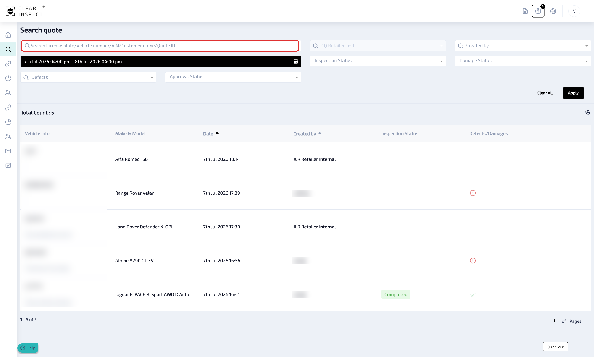
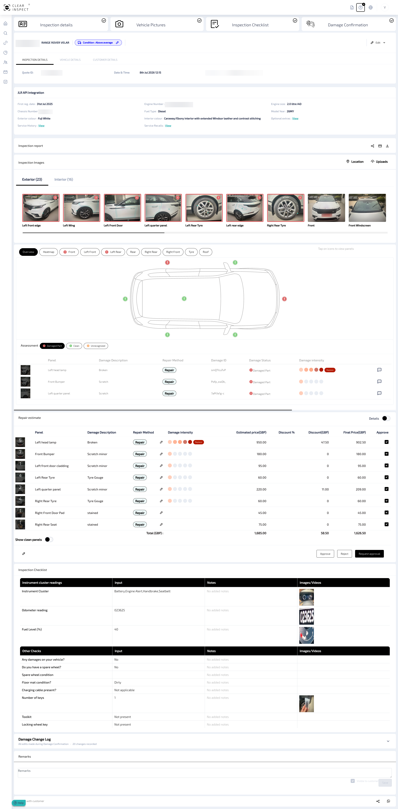

# Viewing and sharing the report

After sign-off, ClearInspect builds the report. View it in the app straight away, or open it later on the web dashboard. From either you can download or share a PDF.

## In the app

The app opens the report automatically at sign-off. It shows:

* Vehicle details (make, model, year, VIN, colour, registration).
* Captured images with damage annotations.
* Tyre information and tread readings.
* Checklist responses.
* The assessment table.
* The repair estimate, if enabled for your retailer.
* For JLR vehicles, extra JLR vehicle data such as service history, recalls, optional extras and engine details (shown under **JLR API Integration** on the web report).

## On the web dashboard

1. Go to [https://jlr-uat.web.app](https://jlr-uat.web.app/) on a desktop browser.
2. Sign in with your inspection credentials.
3. Click the **Search** icon in the left pane.
4.  Find the inspection by registration.

    
5. Click it to open the report.

## Download and share

The **Inspection report** bar on the web report has three icons: **share**, **email** and **download**.

* Use the download icon to save a PDF copy.
* Use the share and email icons to share the report.


The exact buttons and sharing options may vary by retailer setup.


See [Understanding the report](../../web-dashboard/inspection-reports/08-understanding-the-report.md) on the web dashboard for the full breakdown.
