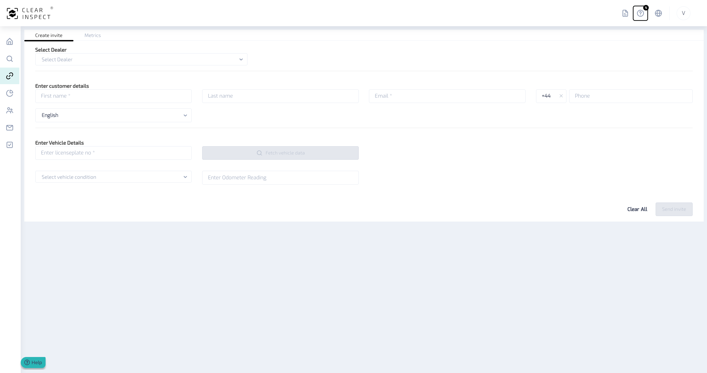
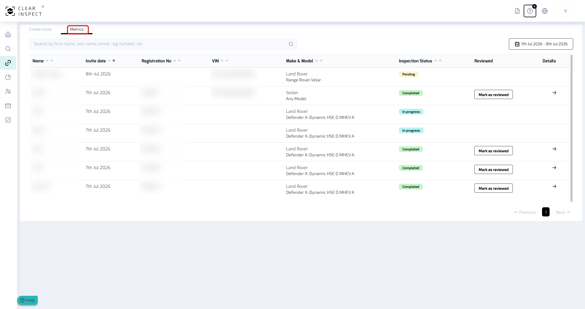

# Inviting a customer to self-inspect

You can invite a customer to appraise their own vehicle using the ClearInspect Client app.


Customer invites are sent from the web dashboard, not from the Retailer app. For the full walkthrough, see [Creating an invite](../../web-dashboard/inviting-customers/05-creating-an-invite.md) and [Tracking invites](../../web-dashboard/inviting-customers/06-tracking-invites.md) on the web dashboard.


## Send an invite

1. Go to https://jlr-uat.web.app on a desktop browser and sign in.
2. Open **Invite (Customer Inspection)** in the sidebar.
3. If you manage more than one retailer, choose the retailer.
4. Enter the client first name, last name and email (all required).
5. Enter the vehicle: select make and model, then the registration or VIN as prompted for your market.
6. Click **Fetch vehicle data**, or enter the details manually.
7. Choose the email language (defaults to yours).
8. Click **Send Invite**.

The invite goes to the client by email. It links to the ClearInspect Client app, and is valid for 48 hours by default.

## Track your invites

Open the **Metrics** tab on the Invite page. For each invite the table shows:

* The customer **name** and **invite date**.
* The vehicle **registration**, **VIN** and **make & model**.
* The **inspection status** - Pending, In progress or Completed.

Completed inspections can be marked as reviewed. Open a row's **Details** to view the inspection.

