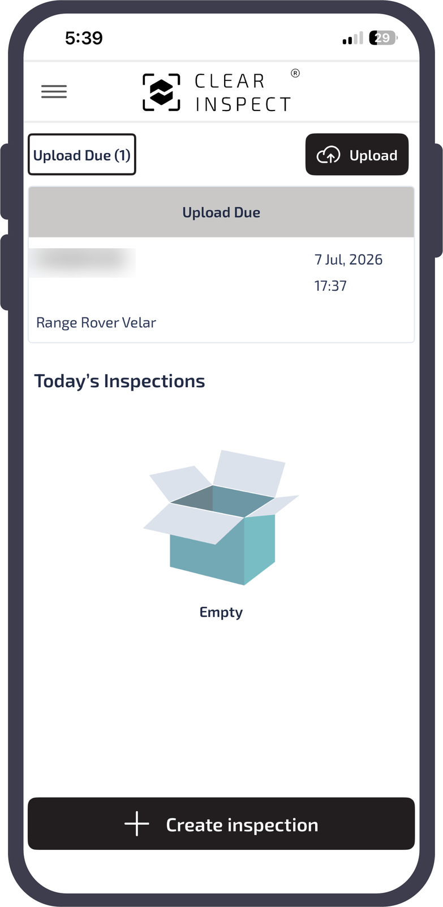

# Working offline

You can create and carry out inspections with no internet connection. Turn **Offline Mode** on first; data uploads when your connection returns.

## Turn Offline Mode on

Offline working is not automatic. Before starting an offline inspection, turn on the **Offline Mode** toggle on the **Vehicle details** screen ([Start an inspection](../inspection/06-start-an-inspection.md)).

_The Offline Mode toggle on the Vehicle details screen - turn it on before starting the inspection._

## What works offline

* Creating a new inspection.
* Carrying it out, including capturing images and completing the checklist.

Everything is stored on the device and syncs once you are back online.

_An inspection created offline sits in Upload Due until you reconnect._

## What needs a connection

* **Vehicle lookup.** If offline, enter the vehicle details manually.

## Make sure your data syncs

* Keep the app open and reconnect to let the inspection sync.
* Do not delete the app before your data has uploaded.

_Keep the app open and connected - the inspection uploads on its own._
