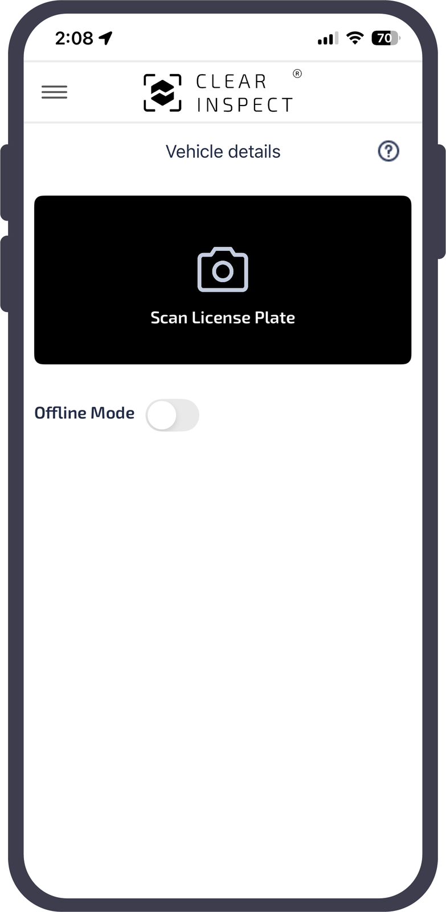
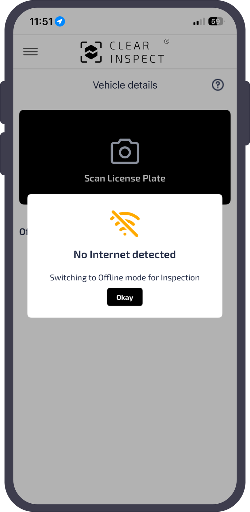
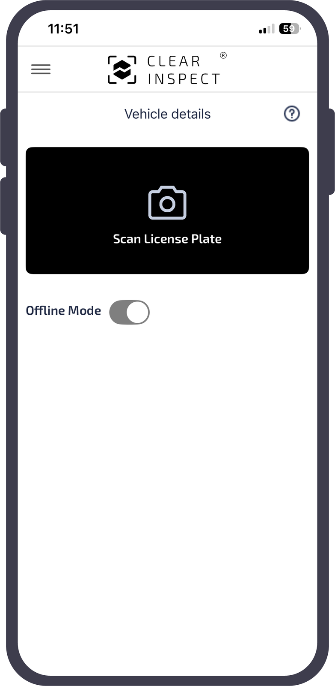
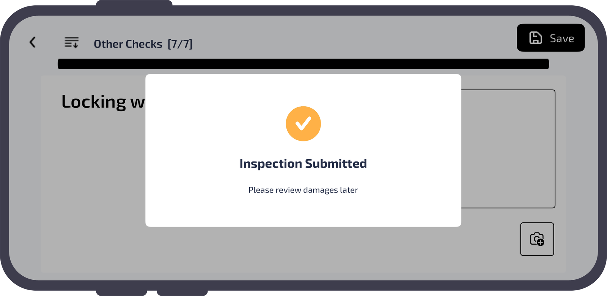
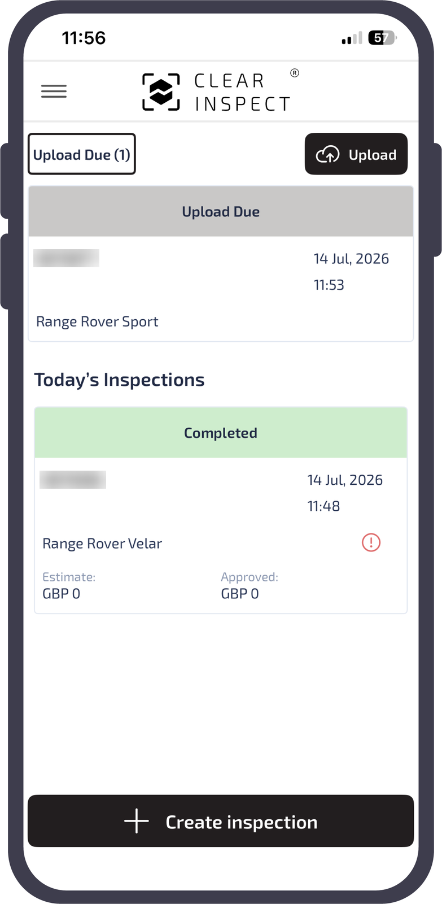
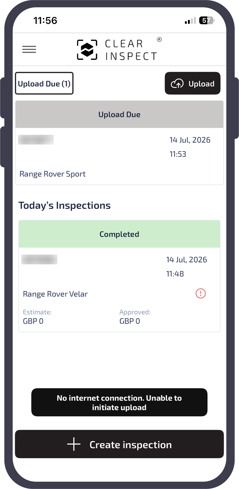
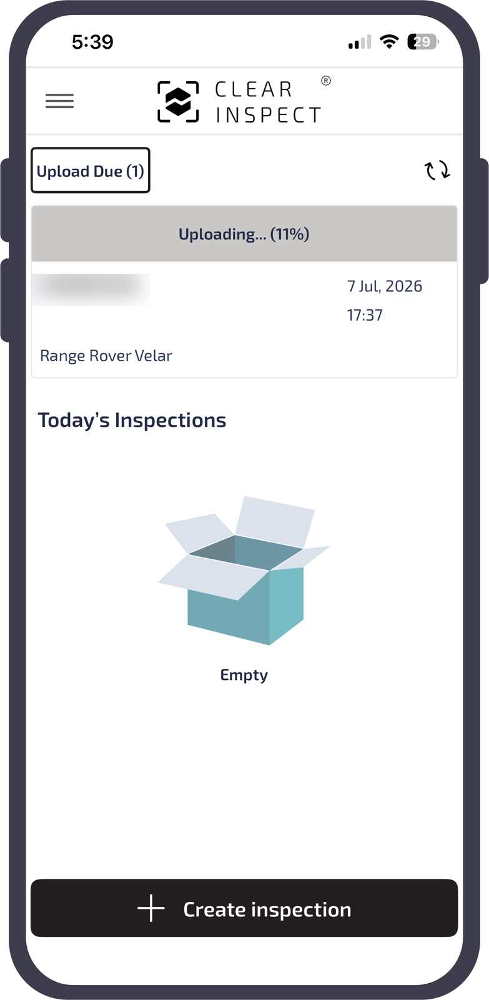
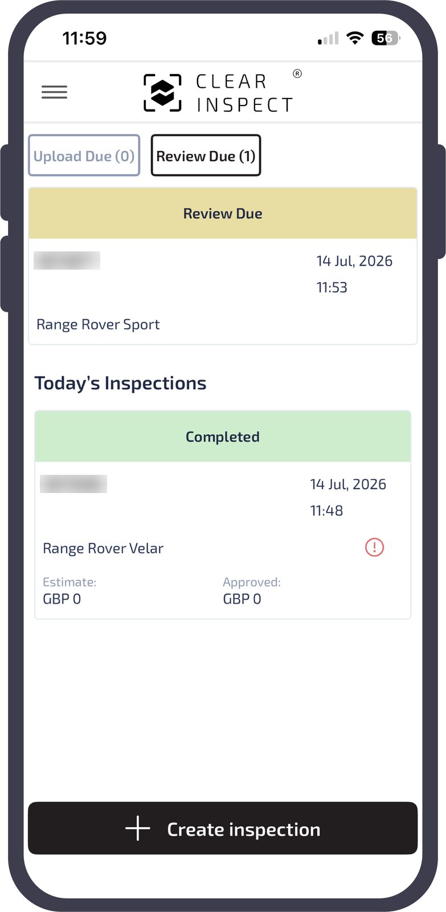
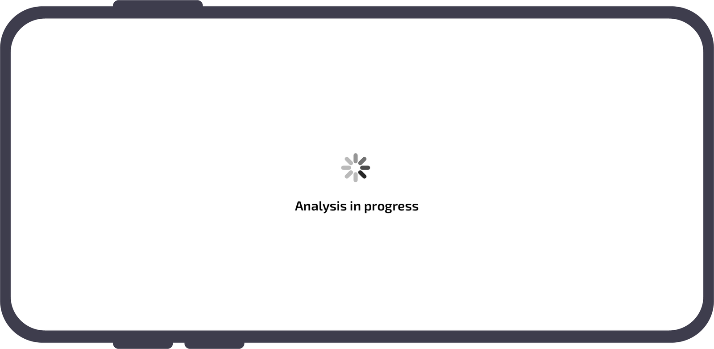

# Working offline

You can create and carry out an inspection with no internet connection. The app stores everything on the device, you upload it when your connection returns, and the damage review happens after the upload.

## Turn Offline Mode on

There are two ways to work offline.

**Turn it on yourself.** Before you start, turn on the **Offline Mode** toggle on the **Vehicle details** screen ([Start an inspection](../inspection/06-start-an-inspection.md)).

_The Offline Mode toggle on the Vehicle details screen - turn it on before starting the inspection._

**Let the app switch for you.** If you tap **Create inspection** with no connection, the app shows **No Internet detected - Switching to Offline mode for Inspection**. Tap **Okay** and Offline Mode turns on for you.

_With no connection, the app offers to switch to Offline Mode - tap Okay._

_Offline Mode is now on and you can carry on with the inspection._

## What works offline

* Creating a new inspection.
* Capturing images - the red/green capture overlays work as normal if they are enabled for your dealer.
* Completing the checklist.

Vehicle lookup is the one thing that needs a connection. If you are offline, enter the vehicle details manually.

## Sign off and review later

When you sign off offline, you see **Inspection Submitted - Please review damages later**. The damage review is not available straight away offline. It runs after the inspection has uploaded.

_Signing off offline - the damage review is done later, after upload._

## Upload when you are back online

The inspection waits in **Upload Due** on the home screen.

_An inspection created offline sits in Upload Due until you reconnect._

You cannot upload while you are still offline. Tapping **Upload** shows **No internet connection. Unable to initiate upload.**

_Uploading is not possible until you have a connection._

Reconnect and keep the app open. Tap **Upload**, or let it upload on its own, and you will see the upload progress. Do not delete the app before your data has uploaded.

_Back online - the inspection uploads on its own._

## Review the damage after upload

Once the upload finishes, the inspection moves to **Review Due**.

_After upload the inspection moves from Upload Due to Review Due._

Tap the **Review Due** card. The app shows **Analysis in progress**, then opens the **Damage Confirmation** screen so you can review the detected damage and sign off ([Reviewing damage](../inspection/12-reviewing-damage.md)).

_Analysis in progress - the app then opens the Damage Confirmation screen._
