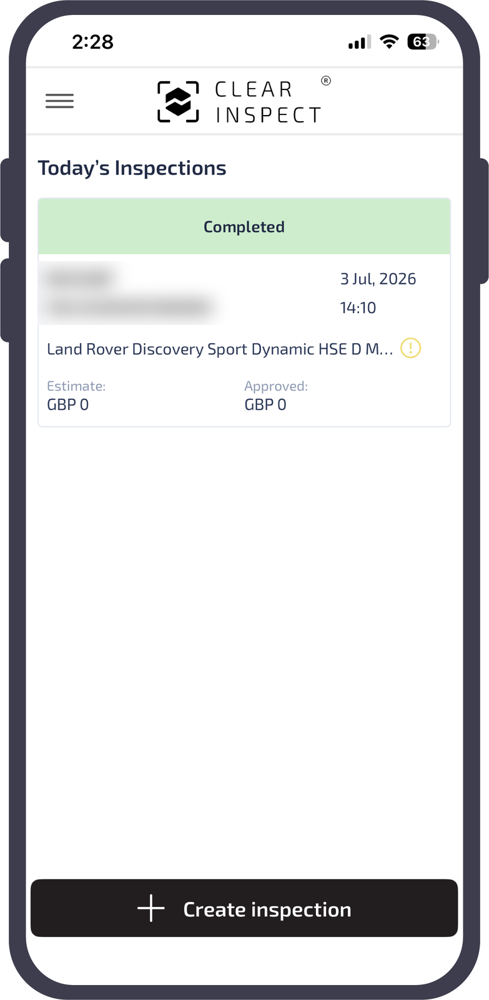

# About ClearInspect

ClearInspect is the JLR vehicle inspection app for retailer staff. You use it to inspect trade-in and used vehicles, then produce a report.

## What you can do

* Start an inspection and look up the vehicle.
* Capture exterior, interior, instrument cluster, tyre and other images using the guided flow.
* Record tyre tread depth and confirm tyre and alloy damage.
* Complete a condition checklist.
* Review detected damage and set repair methods.
* View a repair estimate.
* View and share the report, in the app and on the web dashboard.


There are two ClearInspect apps. The **Retailer app** (this guide) is for JLR retailer staff. The separate **Client app** lets customers self-appraise their own vehicle after an invite. Customers cannot create their own inspections.


_The home screen with a completed inspection card - a quick look at the app in use._

## The web dashboard

Some tasks happen on the web dashboard, not in the app. It is at [https://jlr-uat.web.app](https://jlr-uat.web.app), and you sign in with your app credentials. Use it to:

* View reports in full.
* Manage users (admin accounts only - not covered in this guide).
* Invite customers to self-inspect.


Customers are a separate, invite-only user type. They complete only the inspections assigned to them and cannot sign in to the web dashboard.

