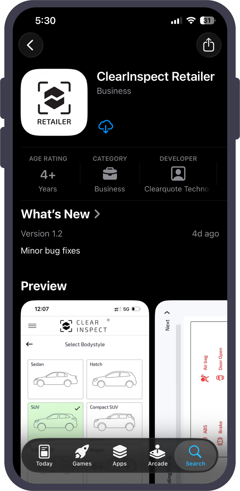

# Installing the app

Install the ClearInspect Retailer app from the Apple App Store. You need an iPhone or iPad and an internet connection.

## Install ClearInspect

1. Open the **App Store**.
2. Search for **ClearInspect**.
3. Open the ClearInspect listing.
4. Tap **Get** to install.
5. Wait for the download to finish.

## Open the app

1. Go to your home screen.
2. Tap the **ClearInspect** icon.


If you have an older inspection app installed, uninstall it to avoid confusion. Keep only the current ClearInspect app.


Next: [Signing in](03-signing-in.md).
