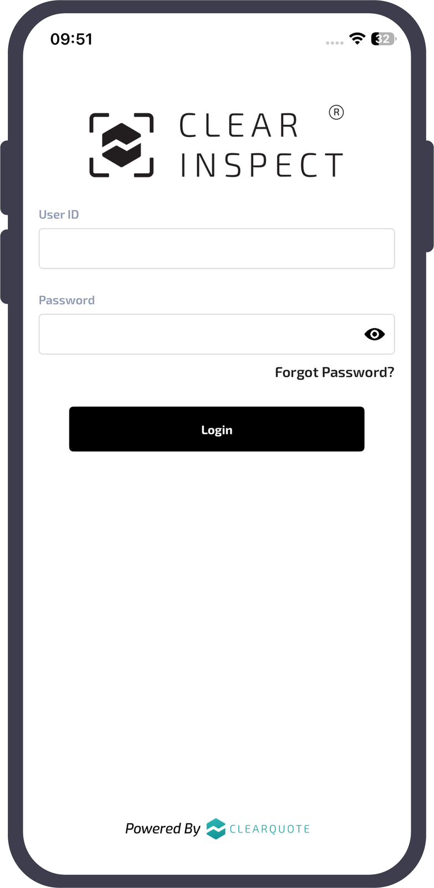
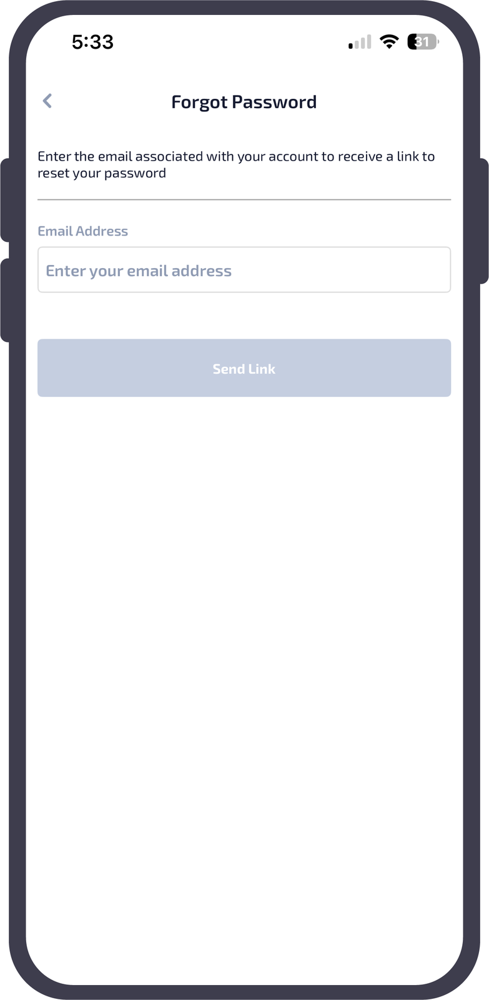
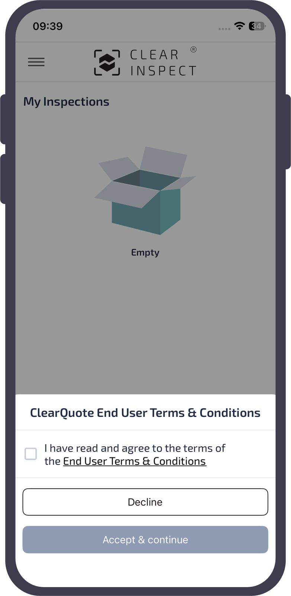

# Signing in

Sign in with the User ID and password your administrator registered for you.

## Before you start

* Use the User ID your administrator registered for you. Your User ID may be the same as your email address, but it can also be different.

## Sign in

1. Open the ClearInspect app.
2. Enter your **User ID**.
3. Enter your **password**.
4. Tap **Login**.


If your User ID or password is wrong, the app keeps you on the login screen. Re-enter them carefully.


## Forgot your password?

1. On the login screen, tap **Forgot Password?**.
2. Enter the email address registered with your account.
3. A password reset link is sent to that email address. Follow it to set a new password.

## Accepting the Terms & Conditions

The first time you sign in, the **ClearQuote End User Terms & Conditions** pop-up asks you to accept before you can continue.

1. Tick **I have read and agree to the terms of the End User Terms & Conditions**.
2. Tap **Accept & continue**. (Tap **Decline** if you do not accept; you cannot use the app without accepting.)

You can view the Terms & Conditions again at any time after login from the sidebar menu.

## Changing the language

Change the app language from the menu after you sign in. See [Changing the language](05-changing-the-language.md).
