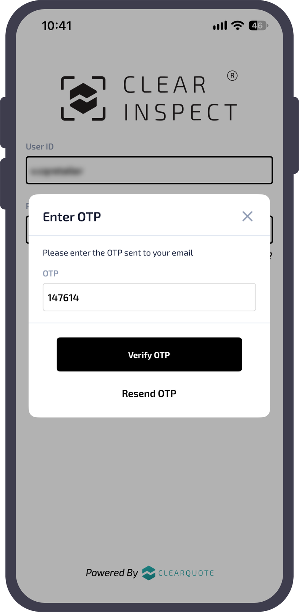

# Signing in

Sign in with the User ID and password your administrator registered for you, then confirm a one-time passcode (OTP) sent to your email.

## Before you start

* Use the User ID your administrator registered for you. Your User ID may be the same as your email address, but it can also be different.
* The OTP is sent to the email address provided when your account was created. Have that inbox to hand on your phone or computer.

## Step 1: User ID and password

1. Open the ClearInspect app.
2. Enter your **User ID**.
3. Enter your **password**.
4. Tap **Login**.


If your User ID or password is wrong, the app keeps you on the login screen. Re-enter them carefully.


## Step 2: Enter the OTP

If your User ID and password are correct, the **Enter OTP** pop-up opens and a one-time passcode is sent to your email.

1. Open your email and find the numeric OTP from ClearInspect. It is sent to the email address provided when your account was created, which may be different from your User ID.
2. Enter the code in the **OTP** field (numbers only).
3. Tap **Verify OTP**. The button becomes active once you have entered the code.

* **No code, or expired?** Tap **Resend OTP**, then check your inbox and spam folder. Resend becomes available after a short countdown (about a minute), shown under the **Verify OTP** button.
* **Wrong code?** Re-enter it carefully.
* **Not sure which email the code went to?** Ask your administrator which email address is registered on your account.

## Forgot your password?

1. On the login screen, tap **Forgot Password?**.
2. Enter the email address registered with your account.
3. A password reset link is sent to that email address. Follow it to set a new password.

## Accepting the Terms & Conditions

The first time you sign in, the **ClearQuote End User Terms & Conditions** pop-up asks you to accept before you can continue.

1. Tick **I have read and agree to the terms of the End User Terms & Conditions**.
2. Tap **Accept & continue**. (Tap **Decline** if you do not accept; you cannot use the app without accepting.)

You can view the Terms & Conditions again at any time after login from the sidebar menu.

## Changing the language

Change the app language from the menu after you sign in. See [Changing the language](05-changing-the-language.md).
