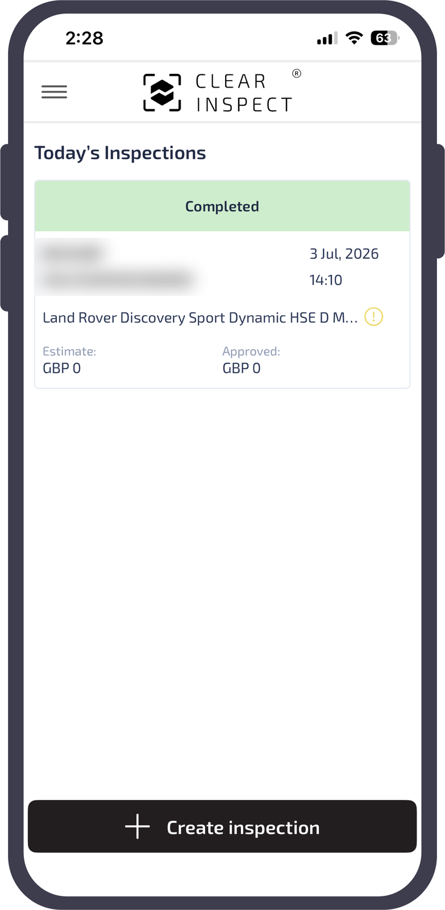

# The home screen

The home screen opens after you sign in. It is your starting point for every inspection.

## What you see

* **Today's Inspections:** cards for the inspections created on the current day, each with its status.
* **+ Create inspection button:** starts a new inspection (bottom of the screen).
* **Menu:** the hamburger icon, for language and other options.

Each inspection card shows:

* The status (for example **Completed**).
* The registration and VIN.
* The date and time.
* The vehicle description (make, model and derivative).
* If the repair estimate is enabled for your retailer, the card also shows the **Estimate** and **Approved** amounts in your market currency.

## Start a new inspection

1. Tap **+ Create inspection**.
2. Follow the prompts to look up the vehicle and begin.

See [Start an inspection](../inspection/06-start-an-inspection.md).

## Resume an inspection

1. Find the card marked **In progress**.
2. Tap it to resume where you left off.

## Open the menu

Tap the **hamburger** icon to change the language and reach other options.
