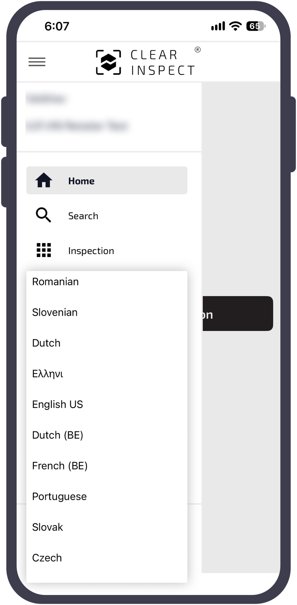

# Changing the language

Change the language ClearInspect uses from the menu after you sign in. The default language is selected based on your region.

## Supported languages

English, German, Spanish, Dutch (Netherlands), Dutch (Belgium), French (Morocco), French (Belgium), Italian, Romanian, Portuguese, Slovak, Slovenian, Czech.

## Change the language

1. Tap the **hamburger** icon on the home screen.
2. Tap the language option.
3. Choose your language.

_Choose your language from the list - the app switches straight away._


Checklist text translation is limited. Some checklist text may still appear in English after you change the language.

