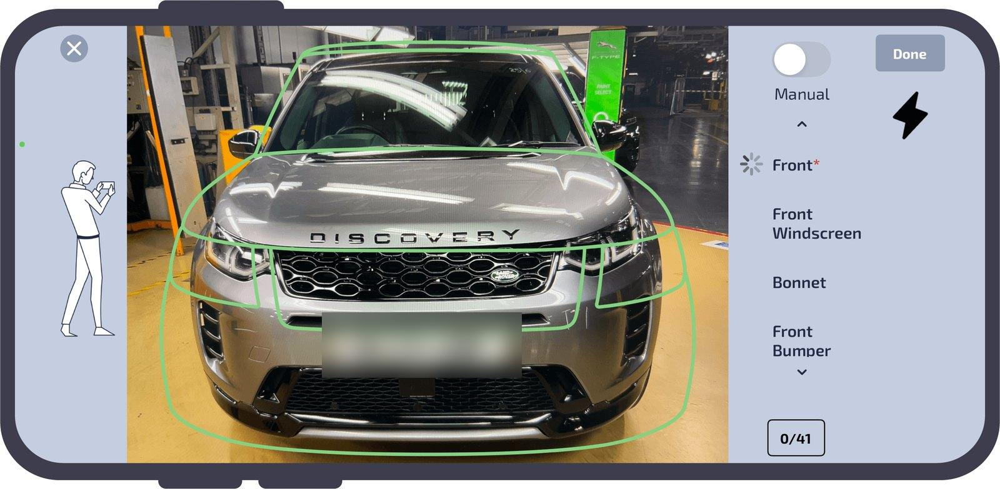
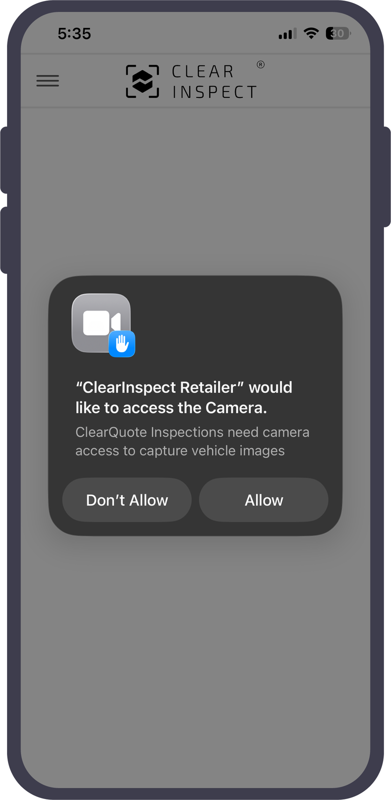

# Tips for good captures

Clear images help ClearInspect detect damage and read details correctly.

## Prepare the vehicle and area

* Clean the vehicle first.
* Park in a well-lit area with room to walk all the way around.
* Use daylight or even lighting.
* Avoid harsh shadows and reflections.

## While you capture

* Hold the phone in landscape.
* Keep the whole panel in frame.
* Wait for the overlay to turn green.
* Let auto-capture fire for exterior images.
* Watch the counter (for example 0/41) to track progress, and tap **Done** when all views are captured.

_The overlay turns green when framing and quality are right - the app then auto-captures._


If an image will not auto-capture, turn on the Manual toggle (top right) and tap the shutter.


## Before and during

* Keep the camera lens clean.
* Turn the ignition on before capturing the instrument cluster.
* Have the keys and charging cable ready for the end-of-capture images.
* Use a good network connection so the inspection uploads.
* Allow camera and location permissions when asked.

