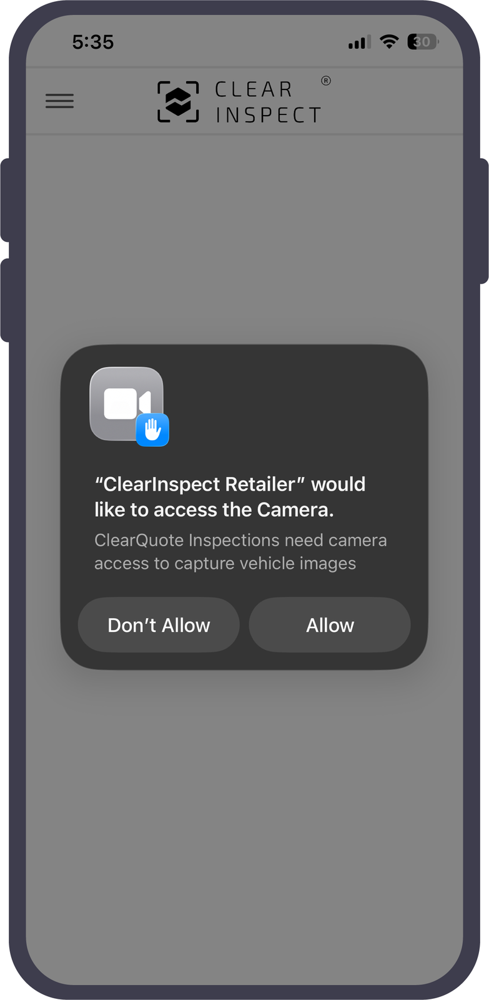
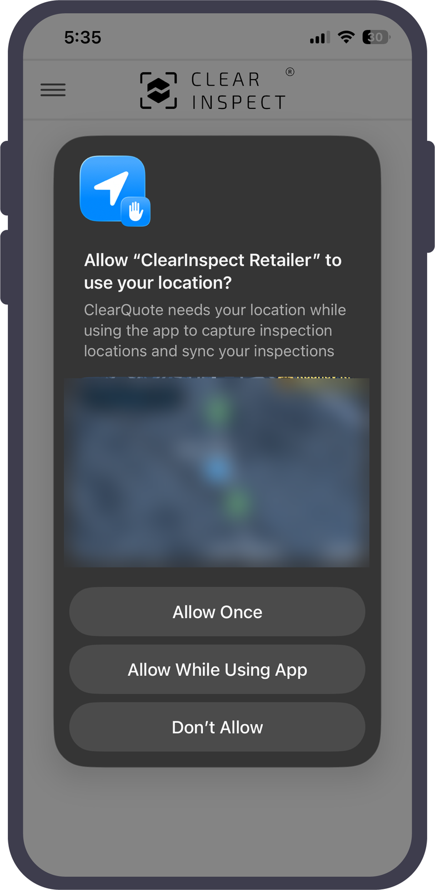
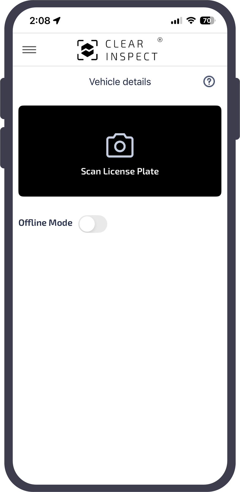
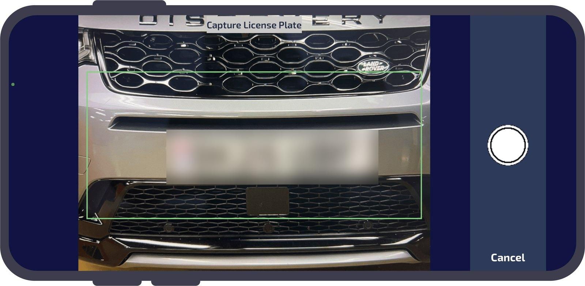
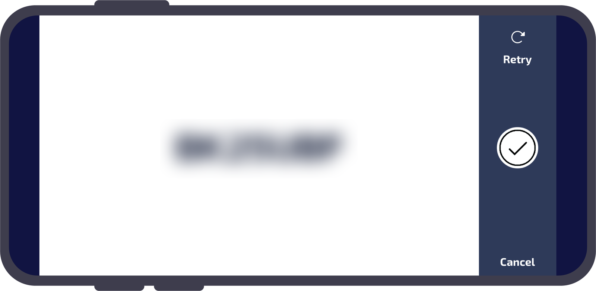
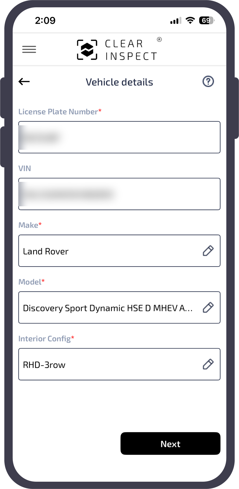
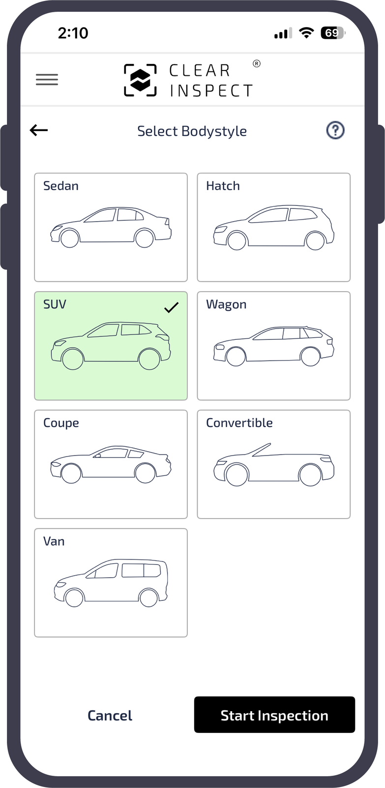

# Start an inspection

Start a new inspection and look up the vehicle. Scan the number plate, confirm the details the app finds, then start the capture flow.

## Before you start

The app needs camera and location access.

1. From the home screen, tap **+ Create inspection**.
2. Grant **camera** permission when prompted.
3. Set **location** to **Allow while using app**.

_Tap Allow for both camera and location so the app can capture images and tag the inspection location._


Tapped Don't Allow earlier? Turn these back on in your device Settings, under ClearInspect.


## Working offline?

The **Vehicle details** screen has an **Offline Mode** toggle. If you have no internet connection, turn **Offline Mode** on before starting the inspection. See [Working offline](../after/18-working-offline.md).

## Scan the number plate

1.  On the **Vehicle details** screen, tap **Scan License Plate**.

    
2.  On the **Capture License Plate** screen, align the registration plate inside the guide and capture the image. Tap **Cancel** to go back.

    
3.  Verify the detected number. Edit the detected value if the app read it wrongly, or tap **Retry** to scan again, then continue.

    

    _Verify the detected number - tap the tick to confirm, or Retry to scan again._


If your screen shows **Scan VIN** instead of **Scan License Plate**, scan the VIN - the steps are the same.


## Confirm the vehicle details

The app pre-fills the vehicle details from the lookup. The form shows:

* **License Plate Number** (required)
* **VIN**
* **Make** (required)
* **Model** (required)
* **Interior Config** (required), for example RHD-3row

1. Check each field and correct it if needed. If the lookup returns nothing, enter the details manually.
2. Tap **Next**.

## Select the bodystyle

The **Select Bodystyle** screen shows a graphic picker - for example Sedan, Hatch, SUV, Wagon, Coupe, Convertible and Van. The options can vary by setup. The detected bodystyle is pre-selected.

1. Correct the bodystyle if required.
2. Tap **Start Inspection** to begin capture, or **Cancel** to go back.


For JLR vehicles, additional vehicle data may be retrieved in the background and shown in the report. No action needed in the app.

