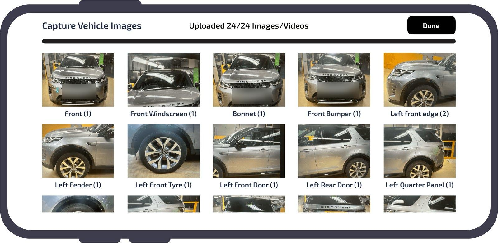

# Capturing exterior images

The app guides you around the vehicle and captures each exterior view for you.

## How the guided flow works

* An **overlay** shows which part to frame, with a **Place vehicle inside outline** prompt.
* **Red** means the framing or quality is not right yet.
* **Green** means it is correct.
* Exterior images **auto-capture** as soon as the overlay is green.
* A list of required views on the right shows what is left (for example Front, Front Windscreen, Bonnet, Front Bumper, Left front edge, Left Fender, Left Front Tyre).
* A counter (for example **0/41**) shows capture progress.
* A figure on the left shows the ideal camera position for each view.

_The overlay with the **Place vehicle inside outline** prompt, the required-views list on the right, and the counter (0/41) before capture starts._

_The same view with the overlay green - framing and quality are right, and the app auto-captures._

## Capture the exterior

1. Stand back so the whole panel fits inside the overlay.
2. Line the overlay up with the matching part of the vehicle.
3. Hold steady and wait for **green**.
4. Let the app **auto-capture**.
5. Move to the next position and repeat around the vehicle.
6. Continue until all required views are captured.


Hold the phone in landscape, keep the whole panel in frame, and use even daylight. Avoid harsh shadows and reflections.


## Using the Manual toggle

If an image is hard to capture, take it yourself:

1. Turn on the **Manual** toggle (top right).
2. Frame the part as best you can.
3. Tap the shutter to capture.

_The Manual toggle sits top right - turn it on to capture yourself._


The Manual toggle is always visible.


## Retaking an image

Select any image and capture it again, following the overlay.

## Finishing capture: upload screen

When all views are captured, tap **Done** (top right). The **Capture Vehicle Images** screen confirms the upload (for example **Uploaded 24/24 Images/Videos**) with a thumbnail per view. Images are uploaded at this stage.

1. Check the thumbnails.
2. Tap **Done** to continue to the checklist.

