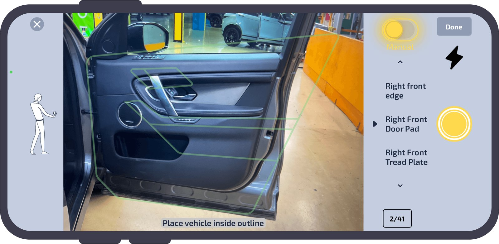

# Capturing interior images

After the exterior, the app guides you through the interior views, such as Door Pads, Tread Plates, Interiors, Dashboard and boot space.

## How interior capture works

* An **overlay** shows each view and checks framing and quality.
* **Red** means not right yet; **green** means correct.
* Interior images do **not** auto-capture. Tap the shutter when the overlay is green.

## Capture the interior

1. Line the overlay up with the matching part (for example Right Front Door Pad, Right Front Tread Plate, Right Front Interior).
2. Hold steady and wait for **green**.
3. Tap the **shutter**.
4. Move to the next view and repeat.
5. Continue until all required interior views are captured.


The interior configuration you confirmed at the start (such as drive side and number of rows) decides which interior views are requested.



If a view will not turn green, turn on the **Manual** toggle (top right) and tap the shutter. If a view stays red for a few seconds, the toggle glows to catch your attention - it is still off, and turning it on is your choice.


## If your overlay stays white

On some setups interior capture is fully manual, just like the exterior. You will know this is you if the **overlay stays white** - it never turns red or green - and there is **no Manual toggle**.

* The white overlay shows which part to frame, but it does not check quality.
* Frame the view as well as you can, then tap the **shutter**.
* Move to the next view and repeat until all required interior views are captured.
