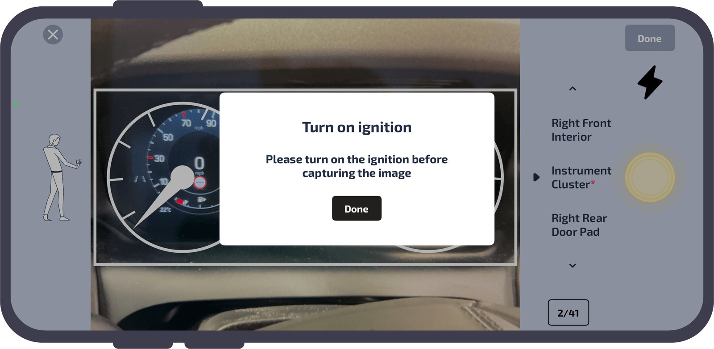
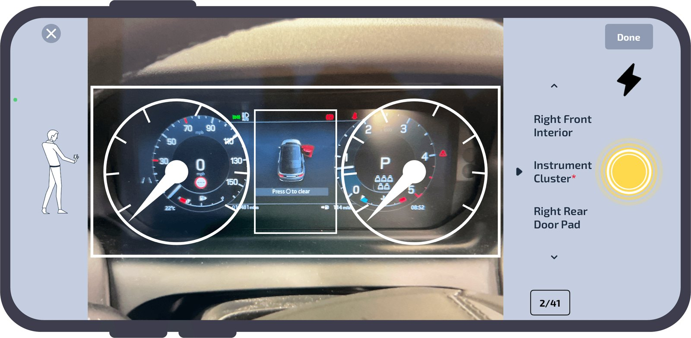
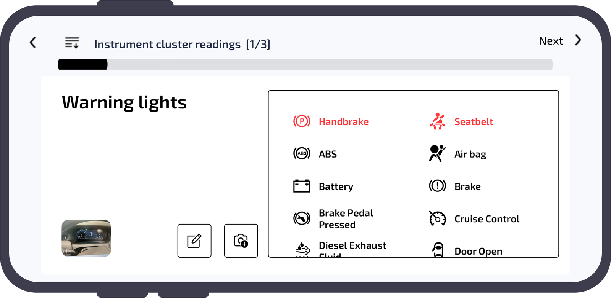

# Capturing the instrument cluster

The instrument cluster image lets the app read the odometer, fuel level and warning lights. These values pre-fill the Instrument cluster readings pages of the checklist.

## Turn the ignition on

Before the capture, the app shows a **Turn on ignition** prompt: "Please turn on the ignition before capturing the image". Turn the ignition on so the dashboard lights up, then tap **Done**.

## Capture the cluster

The instrument cluster is one of the required interior views.

1. Line the frame up with the instrument cluster.
2. Hold steady so the whole cluster sits inside the frame.
3. Capture the image.

_Line the cluster up inside the frame, then capture the image._

## What the app reads

* **Warning lights**
* **Odometer** reading
* **Fuel Level (%)**

After capture, these values pre-fill the **Instrument cluster readings** pages at the start of the checklist ([Completing the checklist](12-completing-the-checklist.md)), where you can edit them if needed.

_The Warning lights page (1/3) pre-filled from the cluster image - here Handbrake and Seatbelt were detected._


If the dashboard is not clear enough, turn the ignition on again, clean the lens, and recapture.

