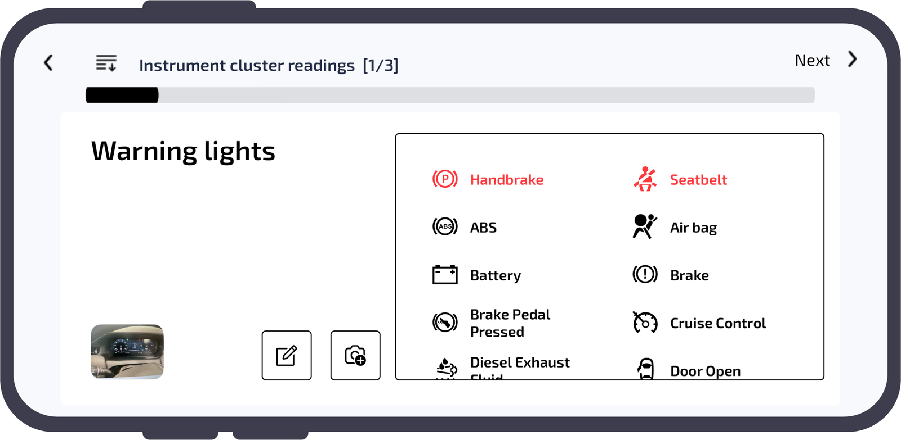
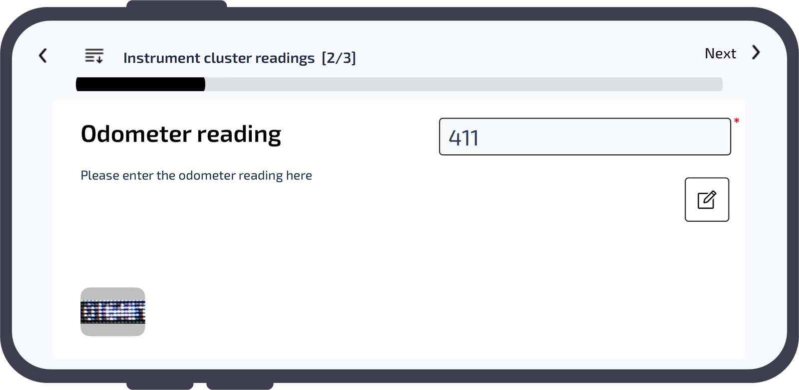
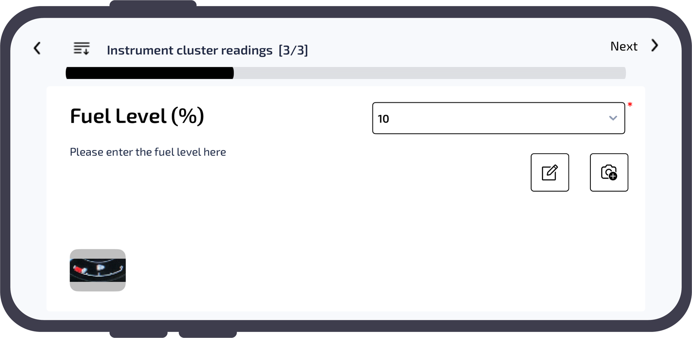
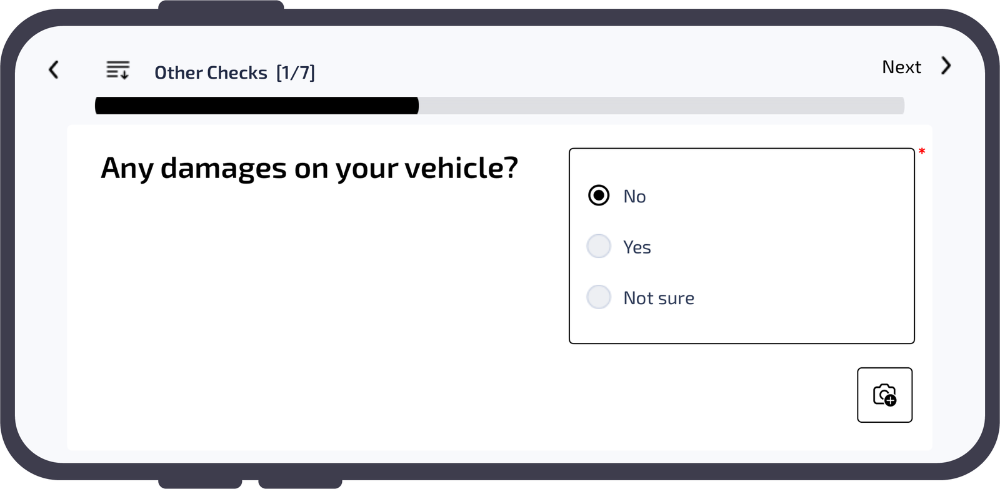
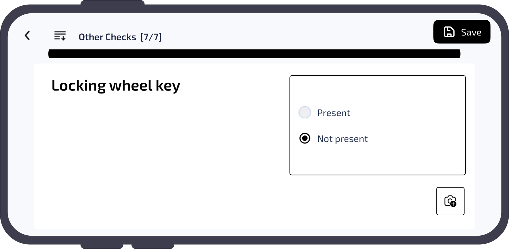

# Completing the checklist

After capture, complete the checklist. It opens with the instrument cluster readings, then asks a set of condition questions. The exact questions, section names and number of pages depend on your dealer setup, so your checklist may be shorter or longer than the examples shown here. Use **Next** (top right) to move between pages.

## Instrument cluster readings

The first pages pre-fill the values detected from the cluster image ([Capturing the instrument cluster](09-capturing-the-instrument-cluster.md)). Check and edit each one, then tap **Next**:

* **Warning lights** - detected lights are pre-selected; edit the selection if required.
* **Mileage / odometer reading** - the reading from the dashboard.
* **Fuel level or charge** - shown on some setups.

_Mileage /_ _Odometer reading, pre-filled from the cluster image - edit it if needed._

_Fuel Level % or Charge, chosen from the dropdown._

## Condition questions

After the cluster readings, the checklist asks a set of condition questions. Depending on your setup this section may be called **Other Checks**, **Vehicle checks** or similar, and the questions vary. Examples include the overall condition of the vehicle, whether there is any damage, the number of keys, chargers or cables, fluid levels, the spare wheel, tools, and service information.

For each question:

1. Read each question.
2. Answer it - tap an option, choose from a dropdown, or type a number.
3. If a photo is needed, tap the camera icon and capture the item.

Some answers open a follow-up question. For example, answering **Yes** to an item may then ask about its condition.

_A condition question. The red asterisk marks a mandatory question; the camera icon attaches a photo._


Mandatory questions are marked with a red asterisk. You cannot move past the checklist until all of them are answered.


## Save the checklist

On the last page, tap **Save** (top right) to complete the checklist section and continue.

