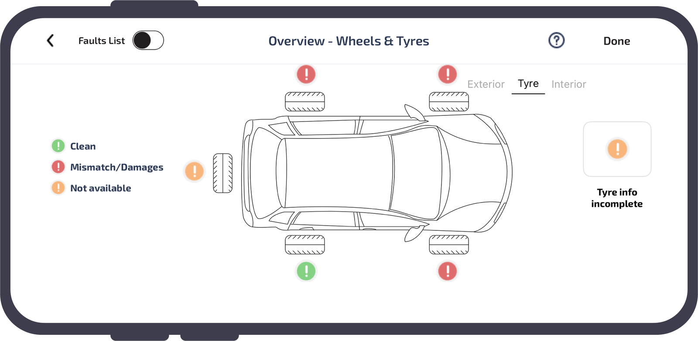
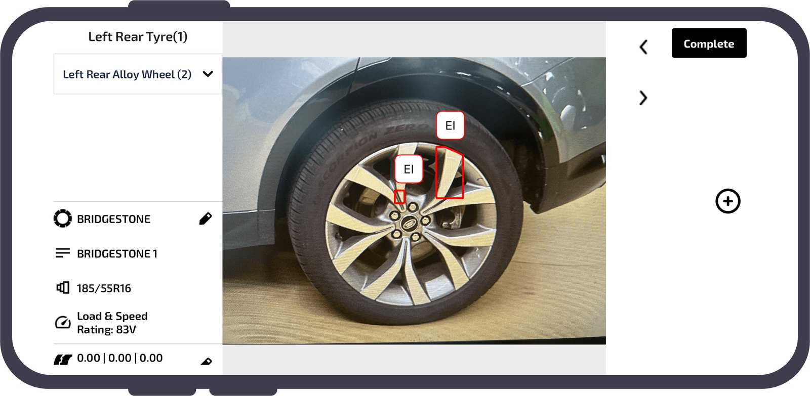
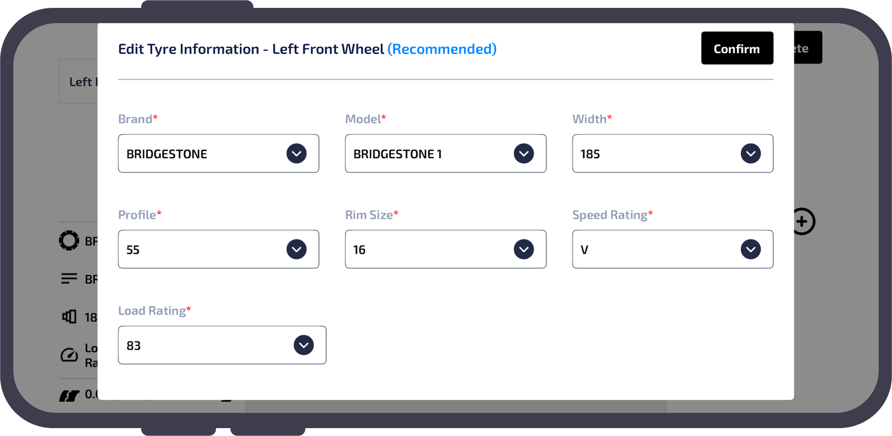
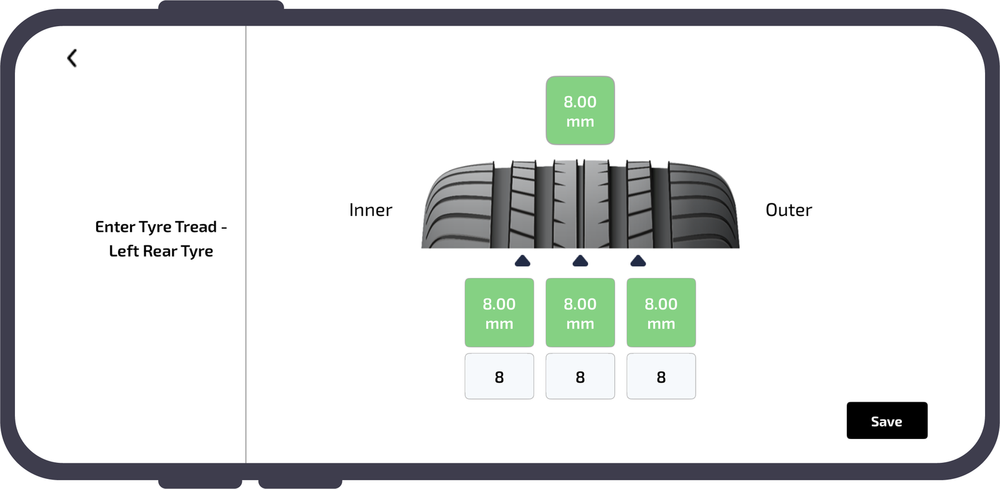
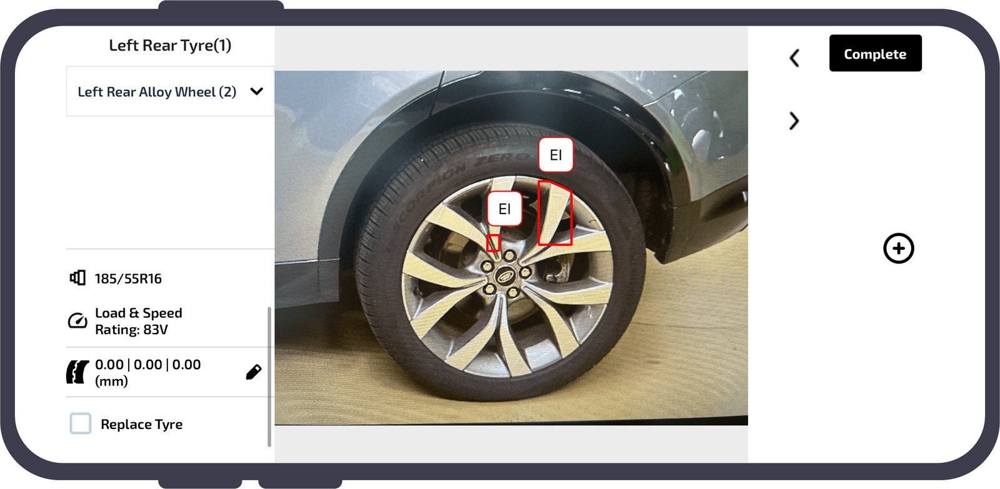

# Tyre inspection

Tyres are inspected from the **Tyre** tab of the damage review overview ([Reviewing damage](13-reviewing-damage.md)). Use it to check each wheel, record tread depth, confirm tyre or alloy damage, and mark tyres for replacement.

## Open the Tyre tab

1. In the damage review **Overview**, tap the **Tyre** tab.
2. The **Overview - Wheels & Tyres** screen shows each wheel on a vehicle graphic.
3. Tap a tyre to select it.

## Wheel status legend

Each wheel has a status icon:

* **Clean:** no issue.
* **Mismatch/Damages:** an issue, such as a tyre out of spec, tyre or alloy damage, or low tread.
* **Not available:** the wheel is not present or not recognised (for example, a spare).

A **Tyre info incomplete** badge shows when tyre information still needs to be entered. The legend and badge are shown in the overview image above.

## Reading and editing tyre information

The app reads each tyre from its image and shows the brand, model, size, and load and speed rating in the left panel, with the tread values below.

To correct the tyre information:

1. Tap the **edit** (pencil) icon next to the tyre details.
2. The **Edit Tyre Information** dialog opens, showing the recommended spec. Choose values from the dropdowns: **Brand**, **Model**, **Width**, **Profile**, **Rim Size**, **Speed Rating** and **Load Rating** (all required).
3. Tap **Confirm** to save.


Tyre fields are chosen from valid options, not typed. Changing a value rechecks it against the spec.


## Entering tyre tread depth

Record tread depth per tyre, with inner, middle and outer readings in mm (decimals allowed).

1. Tap the **edit** (pencil) icon next to the tread values.
2. On the **Enter Tyre Tread** screen, enter the inner, middle and outer values.
3. Tap **Save**.
4. Repeat for all 4 tyres.

## Confirming tyre and alloy damage

Review and confirm any tyre and alloy damage on each wheel. Add or remove damage as you do on other panels ([Reviewing damage](13-reviewing-damage.md)).

## Marking a tyre for replacement

1. Open the tyre in the Tyre tab.
2. Tick the **Replace Tyre** checkbox.

A tyre that is out of spec is ticked for replacement by default. Untick it if you do not want to replace it.

_The Replace Tyre checkbox (bottom left). Tick it to add the tyre to the repair estimate._


Tyres marked for replacement become a line item in the repair estimate.


## Finishing

There is no separate tyre sign-off. When every wheel is checked, tread recorded and damage confirmed, return to the overview and continue the damage review. The single **Done > Sign Off** at the end of the review covers the exterior, tyres and interior together ([Completing and signing off](15-completing-and-signing-off.md)).
