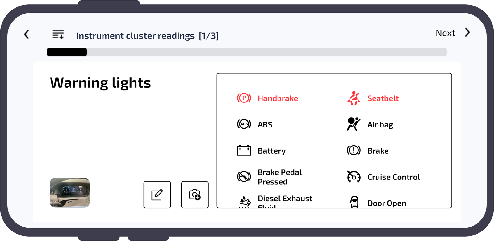
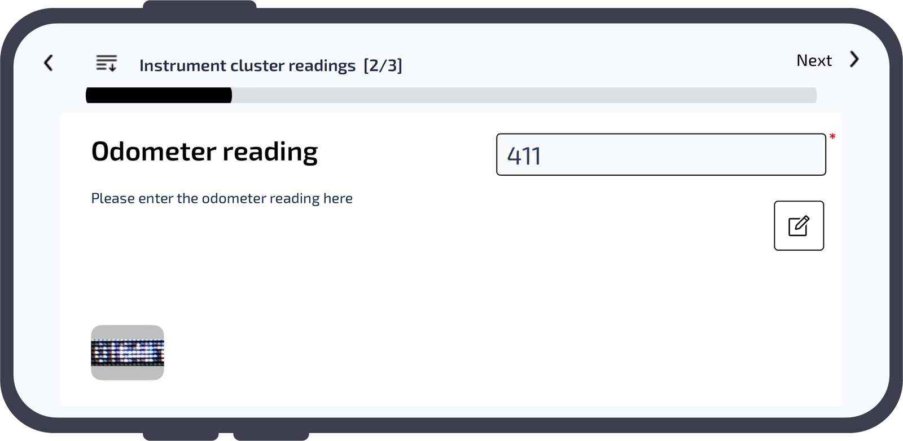
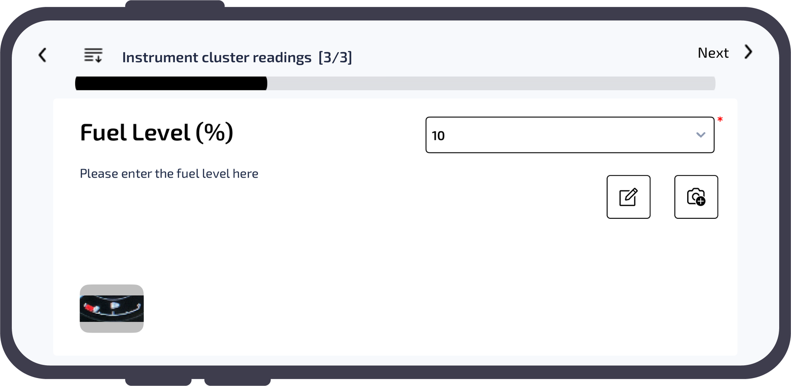
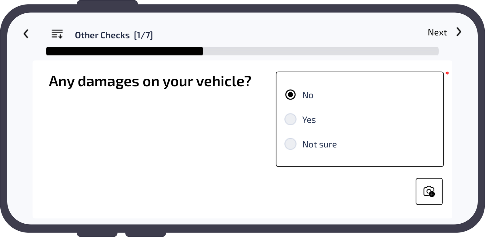
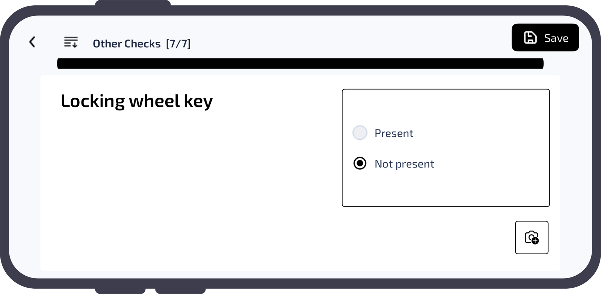

# Completing the checklist

After capture, complete the checklist. It opens with the cluster readings, then asks a short set of condition questions. Use **Next** (top right) to move between pages.

## Instrument cluster readings \[1/3 - 3/3]

The **Instrument cluster readings** pages pre-fill the values detected from the cluster image. Check and edit each, tapping **Next** to move on:

* **Warning lights** - detected warning lights are pre-selected; edit the selection if required.
* **Odometer reading**
* **Fuel Level (%)**

_Odometer reading (2/3), pre-filled from the cluster image - edit it if needed._

_Fuel Level % (3/3), chosen from the dropdown._

## Other Checks \[1/7 - 7/7]

The **Other Checks** pages ask the condition questions, for example "Any damages on your vehicle?" (No / Yes / Not sure) and questions about the keys, charging cable and locking wheel key.

1. Read each question.
2. Tap an option to answer.
3. Attach an image for extra context if needed.

_An Other Checks question. The red asterisk marks a mandatory question; the camera icon attaches an image for context._


Mandatory questions are marked with a red asterisk. You cannot move past the checklist until all of them are answered.


## Save the checklist

On the last page, tap **Save** (top right) to complete the checklist section and continue.

