# Reviewing damage

After the checklist comes damage review - the app calls this **Damage Confirmation**. The app has already detected damage from your images. Review what it found, accept it, correct it, and add anything it missed.

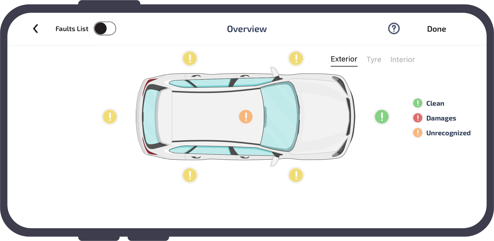

## The overview screen

The **Overview** screen shows the damage status of each section of the vehicle. Tabs switch between **Exterior**, **Tyre** and **Interior**. The legend reads:

* **Clean:** no damage.
* **Damages:** damage present. If vehicle comparison is enabled for your retailer, this label reads **Existing Damages** instead.
* **Unrecognized:** not recognised.

The top bar also has a **Faults List** toggle and a **?** help icon, and **Done** on the right.


Automatic damage detection applies to exterior images. For interior images, review the captured photos and add any damage manually.


Tyre checks are done from the **Tyre** tab - see [Tyre inspection](11-tyre-inspection.md). Interior review works the same way from the **Interior** tab.

## Review a section

1. Tap a section on the overview to open its images.
2. The app shows the image with its detected damage. Detected damages that are not yet picked are marked on the image.
3. Check the damage. Use the arrows on the right edge to move between images, and the panel dropdown (top left) to jump to a panel.
4. After reviewing all panels, tap **Complete** (top right).

_A panel under review with confirmed damages marked; use the panel dropdown to move between panels and tap **Complete** when done._

## Add a damage manually

1. Tap the **+** button.
2.  Choose **Damage** from the menu. (The menu also offers **Image**, and - once a damage is selected - **Closeup**, **Notes** and **Method**.)

    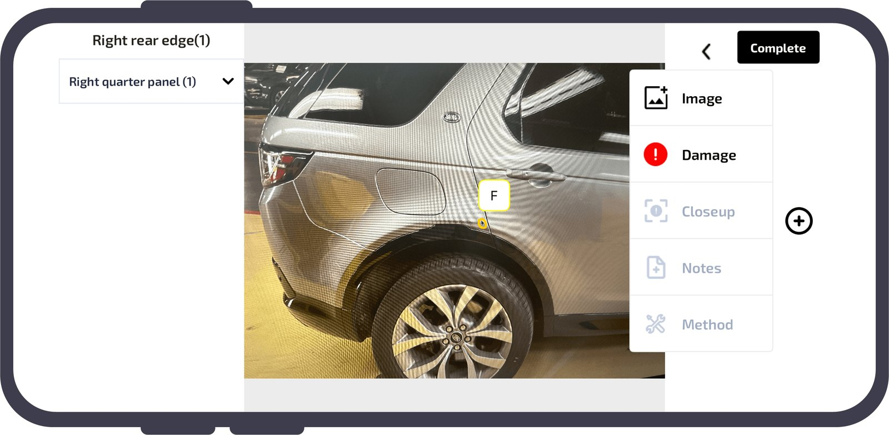
3.  Use the **Draw Mode / Zoom Mode** toggle: switch to **Zoom Mode** to zoom in on the damage, then back to **Draw Mode** to mark it.

    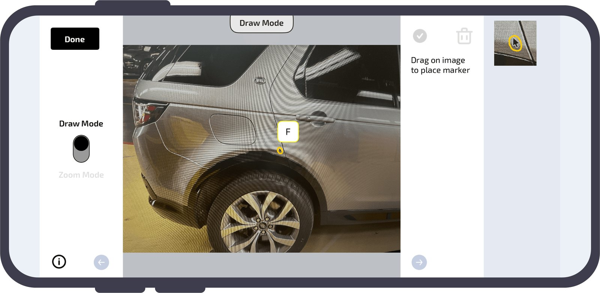

    _Draw Mode: drag on the image to draw around the damage._

    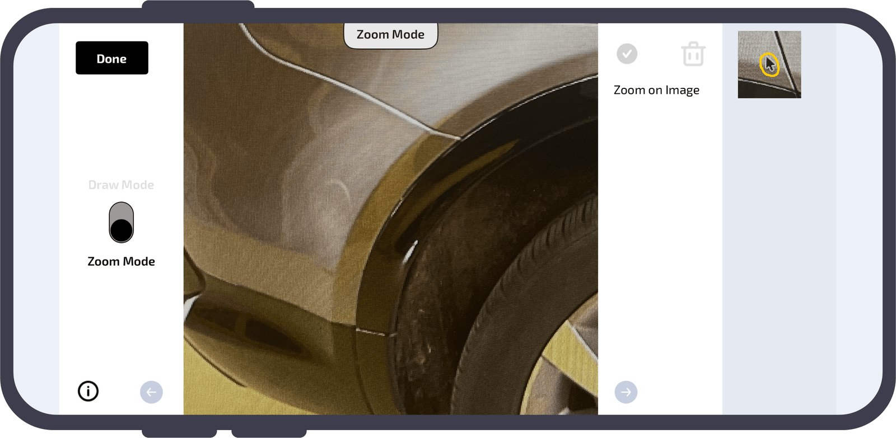

    _Zoom Mode: zoom in on the image for a closer look before marking._
4.  Draw around the damage, then tap the **tick** to save the marking.

    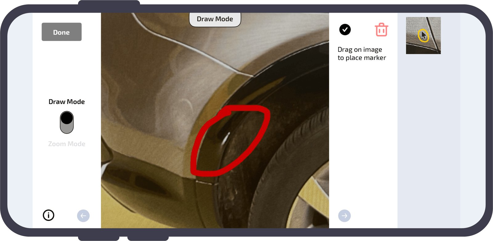

    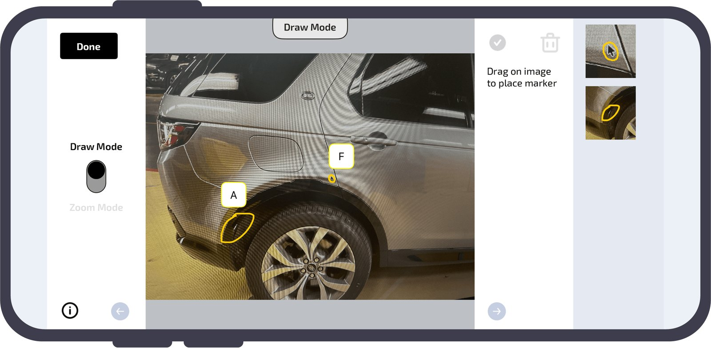

    _You can mark more than one damage on the same image; each marker is given a letter._
5.  In the **Add Damage** dialog, choose the **Select Panel** and **Select damage** values, set the **Damage Area** (Small or Large), then tap **Next**.

    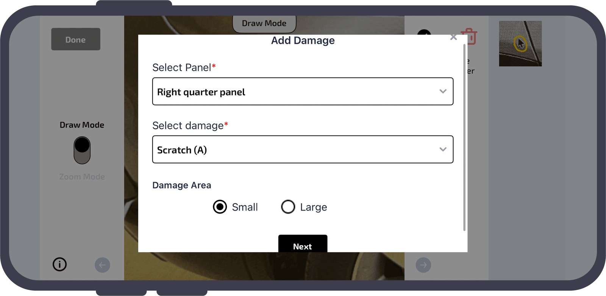

    _The panels offered in **Select Panel** depend on your setup - some setups show a longer list._
6.  In the **Add Repair Method** dialog, pick the **Repair Method** and tap **Save**.

    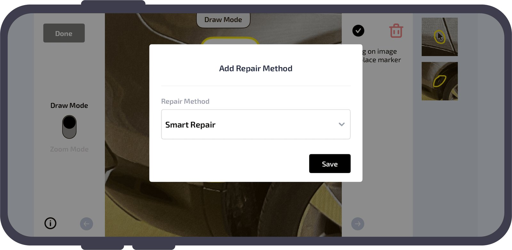
7.  When asked "Add a closeup image for this damage?", tap **Add Closeup** to photograph the damage up close, or **Skip & Save**.

    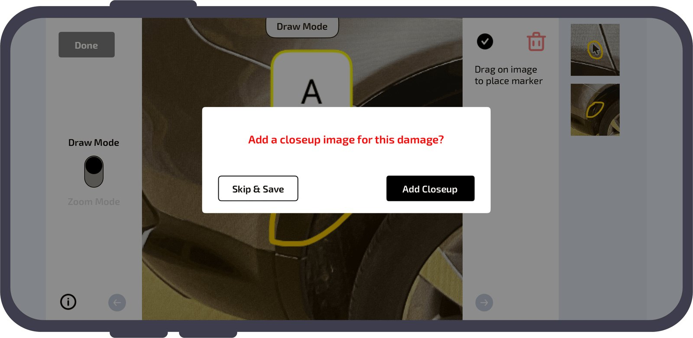
8. Tap **Done** to save the damage.

## Remove a damage

1. Tap the damage on the image, or in the list on the left.
2. Tap the **bin** icon.
3. Confirm "Are you sure you want to delete this damage?" by tapping **Yes**.

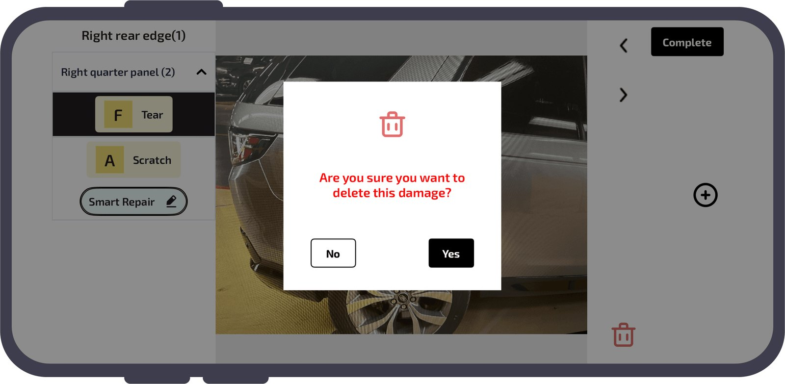

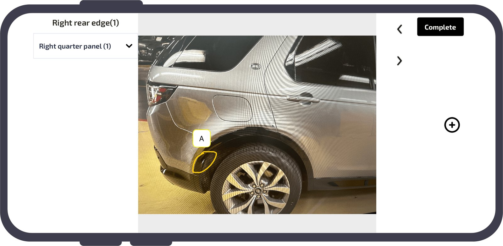

_After deletion the panel's damage count drops (here from two damages to one)._

## Overview-based review (faster)

Work straight from the overview when only a few parts have damage.

1. Find a section with a **Damages** icon.
2. Tap the icon to jump to the damaged part.
3. Review or edit that part.
4. Return to the overview.
5. Repeat for each section that needs attention.

## Finishing the review

1. Tap **Done**.
2. A confirmation dialog appears: "I confirm that all damages/panels are reviewed".
3. Tap **Sign Off**.

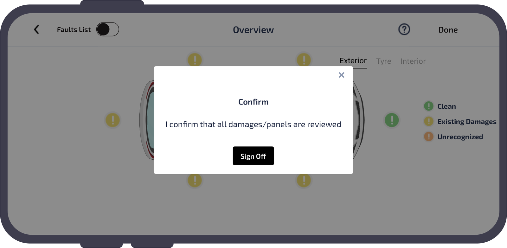
