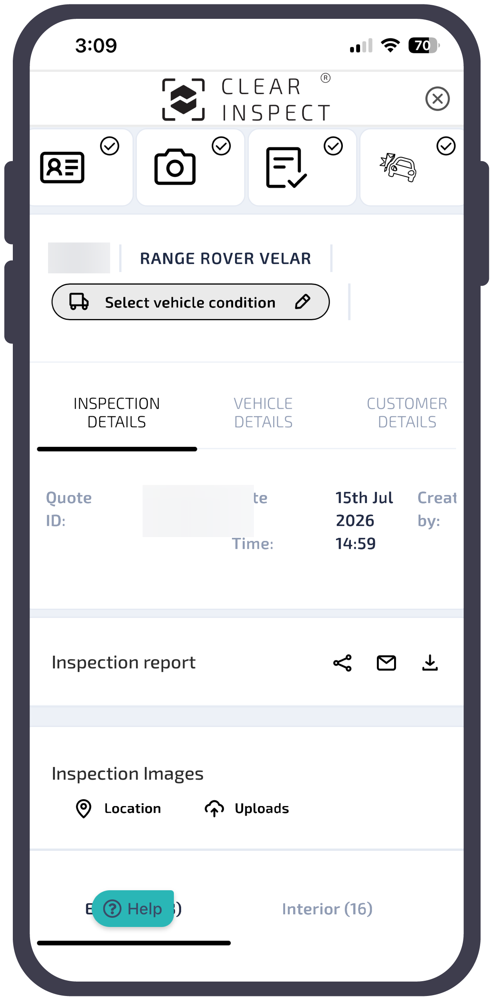
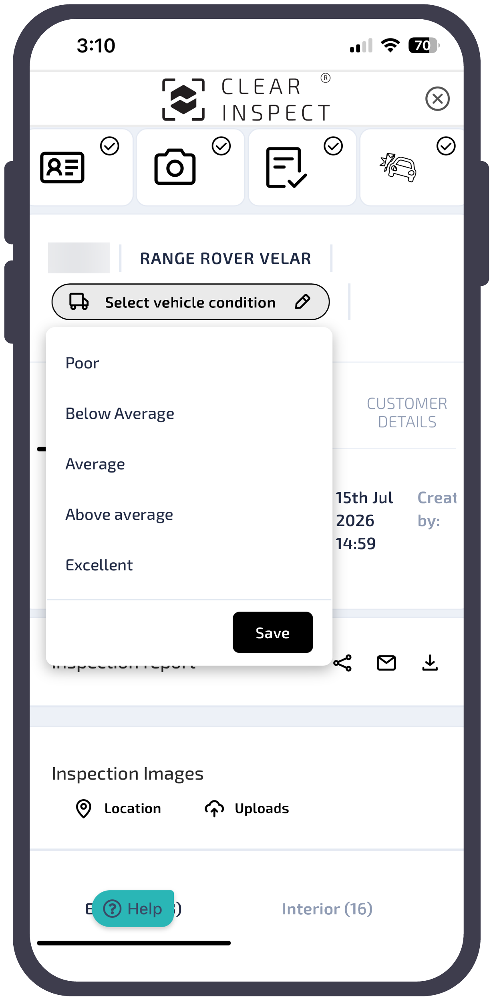
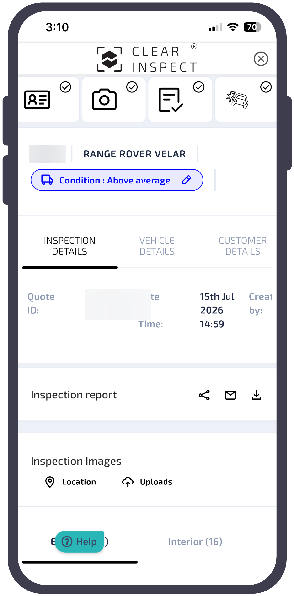
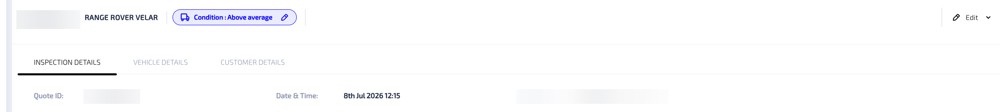
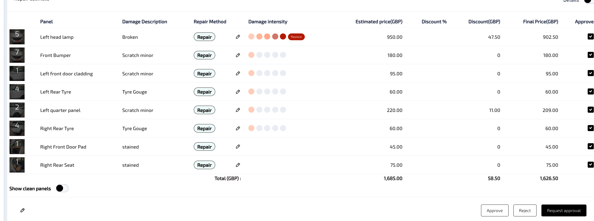

# Condition grade and repair estimate

After the checklist and damage review are done, the report can show an overall **condition grade** for the vehicle, and a **repair estimate** built from the confirmed damage.

## Condition grade

The condition grade is the vehicle's overall rating, and you set it yourself from the app report.

1.  After you complete the inspection, open the report and tap **Select vehicle condition**.

    
2.  Choose one of the five grades - **Poor**, **Below Average**, **Average**, **Above average** or **Excellent** - then tap **Save**.

    
3.  The **Condition** chip now shows the grade you selected.

    

The grade also appears on the web dashboard report as a **Condition** chip in the vehicle header, just above the JLR API Integration section - see [Understanding the report](../../web-dashboard/inspection-reports/08-understanding-the-report.md). You can also change the grade from the web dashboard by tapping the pencil icon on the **Condition** chip.

<!-- RA14-2 -->

_The Condition chip on the web dashboard report._

## Repair estimate

Once the checklist and damage review are done, the system builds a repair estimate. It appears in the report.


Once you sign off the inspection, the repair estimate is calculated automatically and shown in the report on the web dashboard - the screens below are from the web dashboard, not the app. The **Estimate** and **Approved** totals also appear on the inspection card on the app home screen.


The estimate is built from the confirmed damages and their repair methods, and any tyres marked for replacement.

* The repair method is shown for each damage.
* Pricing reflects the method chosen.
* Tyres marked for replacement appear as line items.

**If your estimate shows rows you did not add** - on some setups the estimate always includes a set of standard line items on every inspection, even when no damage is found, and the panel list can be longer. The totals still update as damages and repair methods are edited.

On the web dashboard, the estimate can be edited and sent to the customer for approval - see [Editing damages](../../web-dashboard/inspection-reports/09-editing-damages.md).

<!-- RA14-1 -->


The repair estimate is optional and depends on your dealer setup, so figures may vary by retailer setup.

