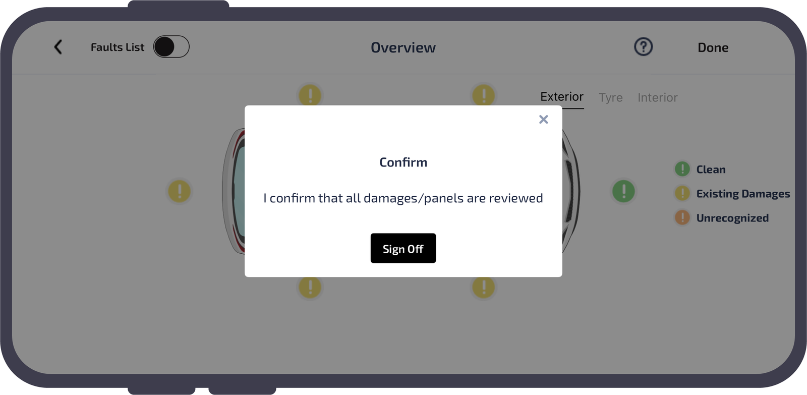
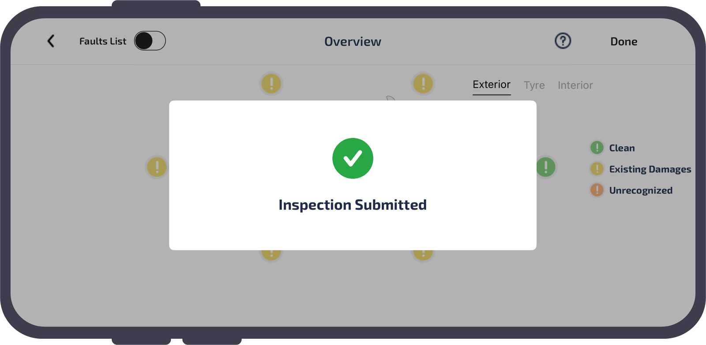

# Completing and signing off

When the damage review is done, sign off to complete the inspection. The app then opens the report.

## Sign off

1. After the damage review, tap **Done**.
2. A confirmation dialog appears: "I confirm that all damages/panels are reviewed".
3. Tap **Sign Off**.

An **Inspection Submitted** confirmation appears. The inspection is now complete.

## The in-app report opens

After sign-off, the app opens the in-app report so you can check the result straight away. The completed inspection also appears on the home screen. If the repair estimate is enabled for your retailer, the card also shows the **Estimate** and **Approved** totals.


The next page covers what the report shows and how to view and share it, in the app and on the web dashboard.

