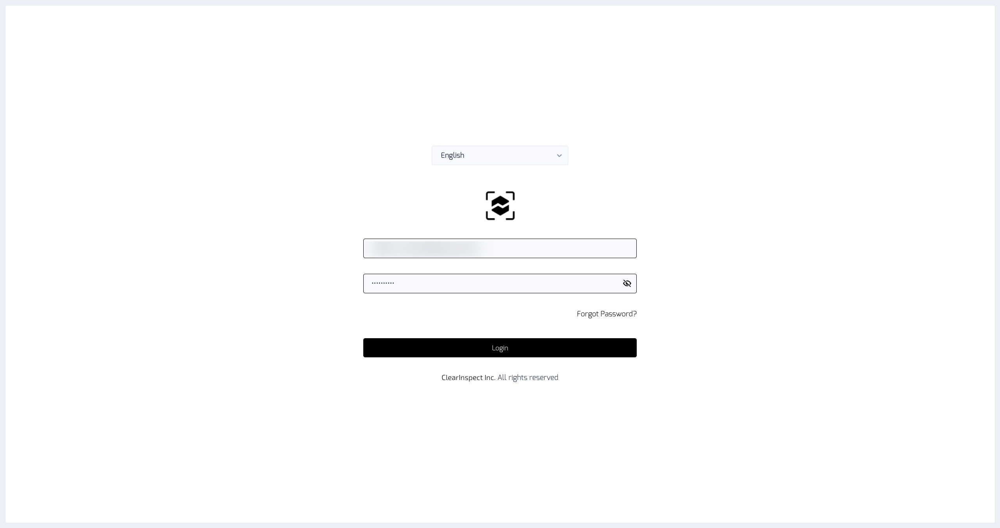
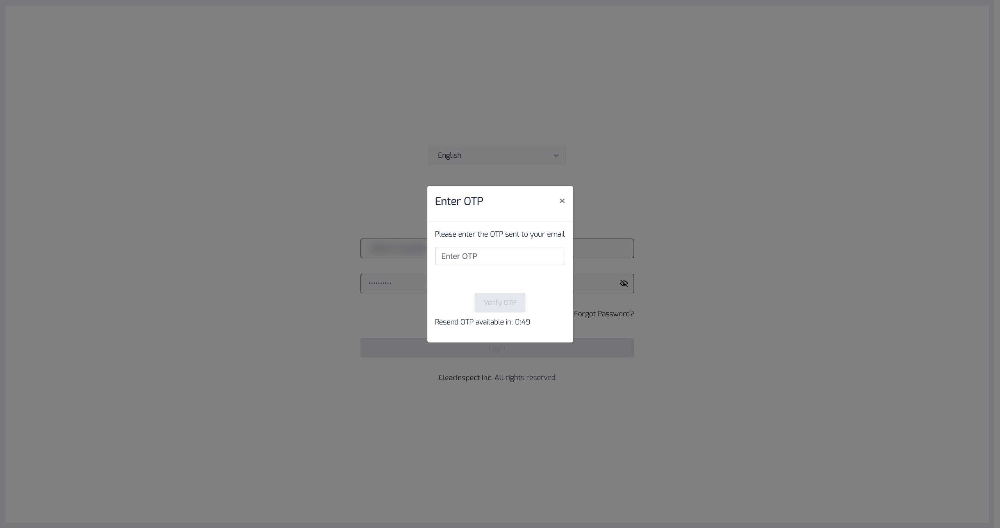
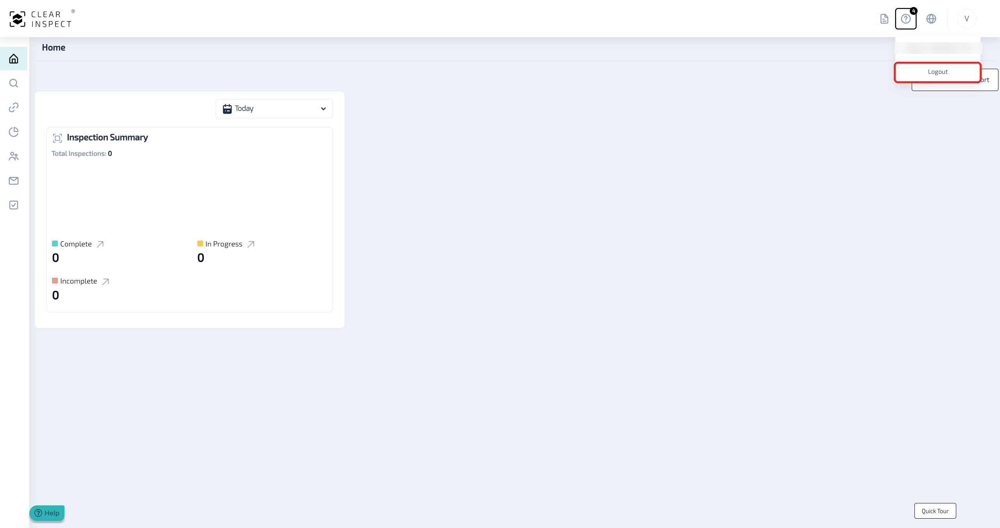

# Signing in

Sign in to the web dashboard with your email and password, then confirm a one-time passcode (OTP) sent to your email.

## Before you start

* Use the email address your administrator registered for you.
* Your administrator must have provisioned you as a ClearInspect user before you can sign in.
* Have your email inbox to hand to read the OTP.

## Step 1: Email and password

1. Go to [https://jlr-uat.web.app](https://jlr-uat.web.app) in a desktop browser.
2. Enter your **email address** and **password**.
3. Click **Login**.

## Step 2: Enter the OTP

If your email and password are correct, you are asked for a one-time passcode.

1. Open your email and find the numeric OTP from ClearInspect.
2. Enter the **OTP** (numbers only).
3. Submit to finish signing in.

* **No code, or expired?** Use **Resend** (wait for the cooldown if shown), then check your inbox and spam folder.
* **Wrong code?** Re-enter it carefully.

## Accepting the Terms & Conditions

The first time you sign in, a pop-up asks you to accept the Terms & Conditions before you can continue.


If you see an error after signing in, check that your administrator has added you to ClearInspect. Contact your retailer admin or the ClearInspect support team if the issue persists.



JLR ForgeRock single sign-on is planned as the long-term sign-in method but is not yet available. For now, all users sign in with email, password and an email OTP.


## Signing out

Click your profile icon in the top-right corner and select **Sign out**.

