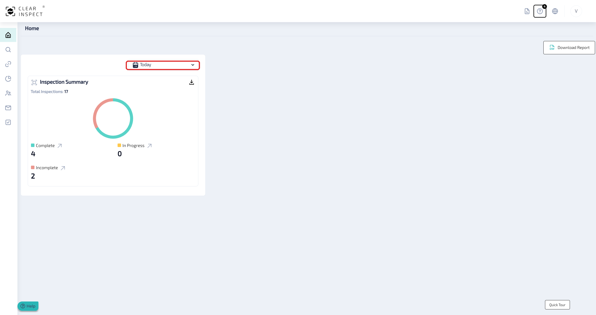

# The home screen

After signing in, the home screen shows an **Inspection Summary** card that gives you a quick read on inspection activity at your retailer. Use the date filter at the top (for example, **Today**) to change the period.

## Inspection Summary

Shows the total number of inspections for the selected period, broken down by status.

| Status | What it means |
|---|---|
| **Complete** | The inspection has been signed off and the report is ready. |
| **In Progress** | The inspection has been started but not yet signed off. |
| **Incomplete** | The inspection was started but not completed within the expected window. |

A **Total Inspections** count is shown at the top of the card.


The counts on the home screen reflect your access level.


## Navigation

Use the sidebar on the left to move between sections of the dashboard:

* **Home** - the Inspection Summary card.
* **Search** - find any inspection by registration, VIN or customer name.
* **Invite** - send a new customer inspection invite.
