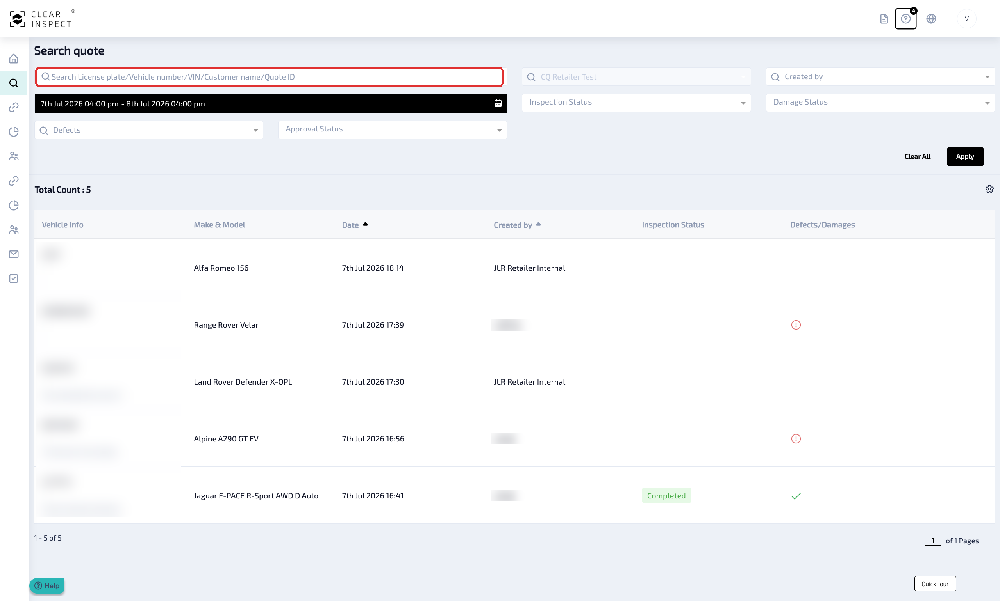

# Finding an inspection

Use the Search function to find any inspection - whether carried out by a retailer in the Retailer app, or by a customer via an invite.

## Search for an inspection

1. Click the **Search** icon in the sidebar. The **Search quote** page opens.
2. Enter one of the following in the search box:
   * Licence plate or vehicle number
   * VIN
   * Customer name
   * Quote ID
3. Click **Apply**.

Results appear as a list of matching inspections.

## Filter results

Narrow down results using the filter options:

* **Inspection Status**, **Damage Status**, **Defects** and **Approval Status** - narrow by status.
* **Date range** - set a start and end date.
* **Retailer** - shown if your account covers more than one retailer.
* **Created by** - find inspections by a specific team member.

Set your filters, then click **Apply**. Use **Clear All** to reset them.

## Open an inspection

Click any result to open the inspection report. See [Understanding the report](08-understanding-the-report.md) for a full breakdown of what the report contains.


Your search results are limited to the inspections your account has access to.

