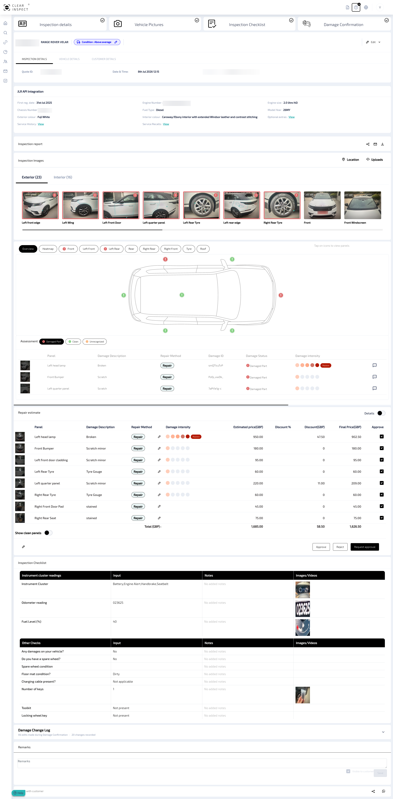
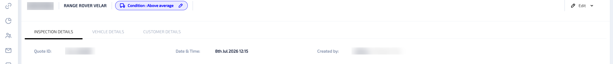
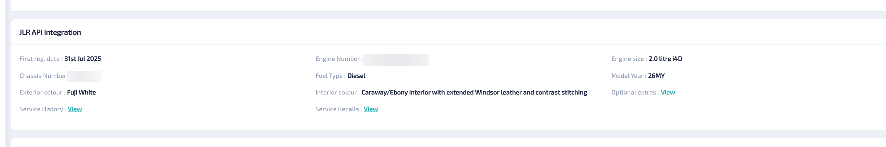
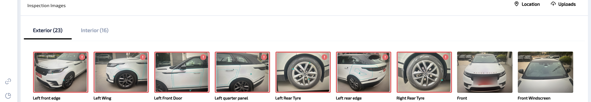
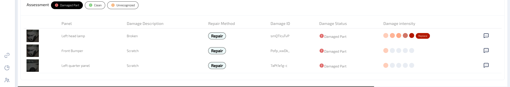
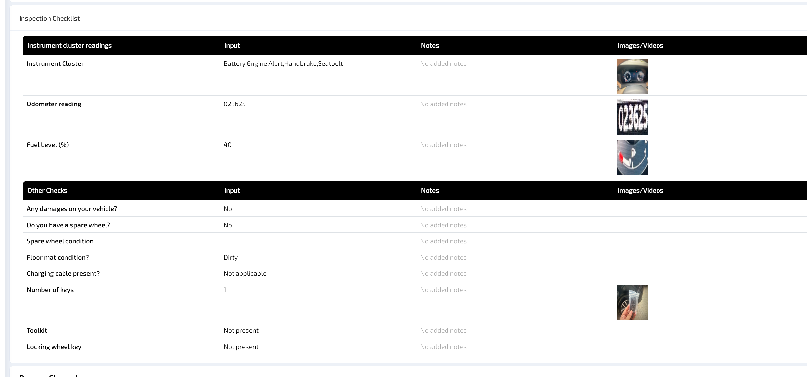
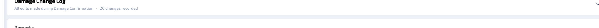
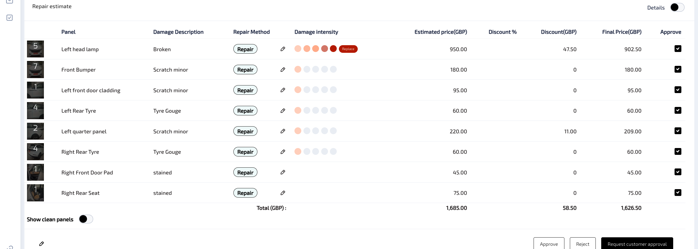

# Understanding the report

The inspection report brings together everything captured during the appraisal. Scroll through the sections described below.

_The full inspection report - scroll through the sections below._

## Progress tracker

At the top, four stages show the state of the inspection, each ticked when complete:

* **Inspection details**
* **Vehicle Pictures**
* **Inspection Checklist**
* **Damage Confirmation**

## Vehicle header and details tabs

Below the tracker, the vehicle header shows the registration and the vehicle description, with an **Edit** dropdown and a **Vehicle details** link.

Three tabs follow: **INSPECTION DETAILS**, **VEHICLE DETAILS** and **CUSTOMER DETAILS**. The Inspection details tab shows the **Quote ID**, **Date & Time**, **Customer Name** and **Created by**.

## JLR API Integration (JLR vehicles only)

For JLR vehicles, the **JLR API Integration** section shows extra data retrieved automatically using the vehicle's VIN:

* First registration date.
* Chassis number and engine number.
* Engine size and model year.
* Fuel type.
* Exterior and interior colour.
* Optional extras (View).
* Service history (View).
* Service recalls (View).

This data is retrieved automatically during the inspection - no action is needed in the app.

## Inspection report bar

The **Inspection report** bar has three icons: **share**, **email** and **download**. See [Sharing and downloading](10-sharing-and-downloading.md).

## Inspection Images

The **Inspection Images** section has **Location** and **Uploads** buttons and two tabs: **Exterior** and **Interior**, each with its image count. Detected damages are marked with letter annotations on the images (for example "A: Scratch").


Automatic damage detection applies to exterior images. Interior images are shown for review, and any interior damage is added manually.


## Panel overview

Below the images, chips filter the panel view: **Overview**, **Heatmap**, **Front**, **Left Front**, **Left Rear**, **Rear**, **Right Rear**, **Right Front**, **Tyre** and **Roof**. Click an icon to view that panel. The interior overview also has **Main** and **Extras** chips.

### Tyre information

Tyre details live in the **Tyre** tab of this overview section, just above the assessment/comparison section. For each wheel it shows:

* Tyre brand and size.
* Tread depth readings.
* Any tyre or alloy damage confirmed during the inspection.
* Replacement recommendation.

## Assessment / Comparison

A table lists each damaged panel, the damage type, and the repair method assigned.

When a vehicle with the same licence plate is inspected again, a **Comparison** section appears in place of the assessment section. It compares the **Current Inspection** against the **Previous Inspection** image by image, with filter chips: **New damages**, **Existing Damage**, **Repaired**, **Clear** and **Unrecognized**.

## Checklist responses

All answers to the inspection checklist are listed in the **Inspection Checklist** section, including responses pre-filled from image detection (such as odometer, fuel level and warning lights).

## Change log

Below the checklist section, the report includes a **Damage Change Log** - an audit trail of edits made to the report, including the damage changes inspectors make during Damage Confirmation in the app. Each entry shows the change, who made it and when. The change log is read-only; retention follows your organisation's policy.

## Repair estimate

If enabled for your retailer, the report includes a **Repair estimate** table with a line per damage: **Panel**, **Damage Description**, **Repair Method**, **Damage intensity**, **Estimated price**, **Discount %**, **Discount**, **Final Price** and **Approve**, with a **Total** row and a **Show clean panels** toggle. The estimate can be edited and sent to the customer for approval - see [Editing damages](09-editing-damages.md).

On some setups the estimate also includes standard line items that appear on every inspection, even when no damage is found, so the table can show more rows than confirmed damages.


The repair estimate section only appears if it has been turned on for your retailer. Contact your administrator if you expect to see it but do not.

