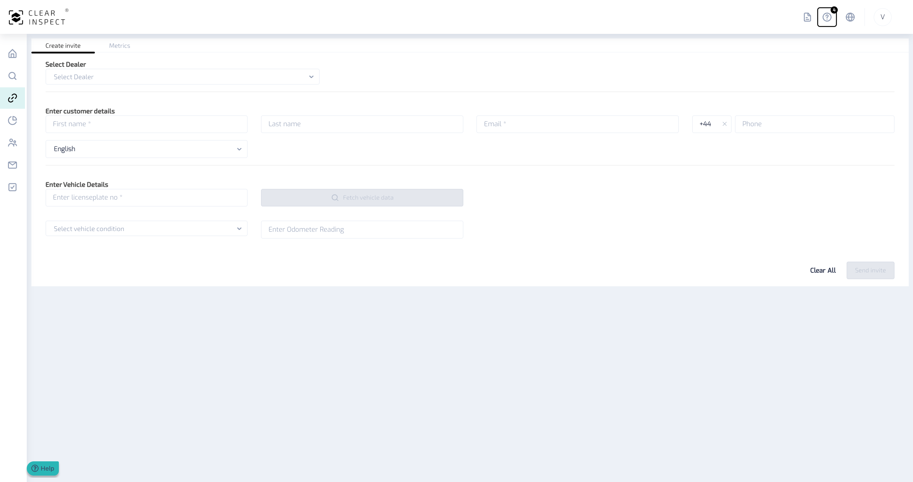
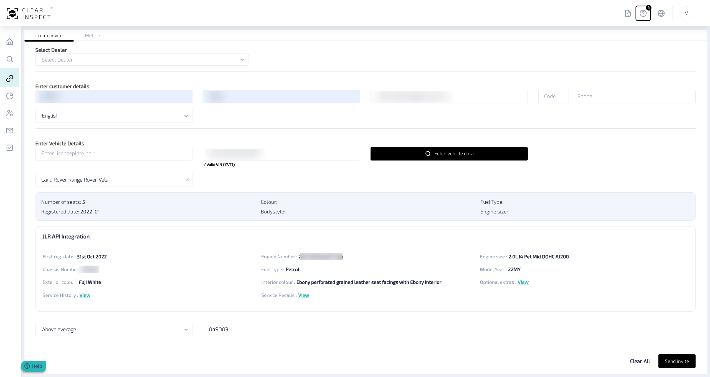

# Creating an invite

Send a customer an invite to appraise their own vehicle. The customer receives a link by email and completes the inspection on their own device using the ClearInspect Client app.

## Before you start

* Have the customer's first name, last name and email address to hand.
* Have the vehicle's registration number (VRM) or VIN.

## Send an invite

1. Click **Invite** in the sidebar.
2. If you manage more than one retailer, select the correct retailer from the dropdown.
3. Enter the **client first name**, **last name** and **email address** (all required).
4. Enter the vehicle details.
   * Select **Make** and **Model** from the dropdowns.
   * Enter the **Registration (VRM)** or **VIN** as prompted for your market.
5. Click **Fetch vehicle data**.

   The dashboard looks up basic vehicle details and displays them for you to check before sending. For JLR vehicles, a more detailed Topix lookup runs automatically in the background during the inspection itself.

6. Confirm the fetched details are correct, or enter them manually if the lookup returns nothing.

   

7. Select the **email language** for the invite (defaults to your profile language).
8. Click **Send Invite**.

A confirmation appears. The customer receives an email within 60 seconds. The invite is valid for 48 hours by default.


If a vehicle lookup returns no data, check that you have entered the correct registration or VIN. You can still send the invite by entering vehicle details manually.


## What the customer receives

The customer email contains:

* A unique link to begin their self-appraisal (one-time use).
* The expiry time.
* Step-by-step instructions and contact details for the inviting retailer.
* A link to download the ClearInspect Client app.

## Vehicle data returned by lookup

For JLR vehicles (Topix / VIN lookup) and non-JLR vehicles (VRM third-party lookup), the fields returned differ.

| Field | JLR (Topix) | Non-JLR (VRM) |
|---|---|---|
| Make | Yes | Yes |
| Model | Yes | Yes |
| Model year | Yes | Yes |
| Number of seats | Yes | Yes |
| First registration date | Yes | Yes |
| Chassis number | Yes | Yes |
| Engine number | Yes | - |
| Engine size | Yes | - |
| Fuel type | Yes | Yes |
| Exterior colour | Yes | Yes |
| Interior colour | Yes | - |
| Optional extras | Yes | - |
| Service history | Yes | - |
| Service recalls | Yes | - |
| Bodystyle | Yes | Yes |
