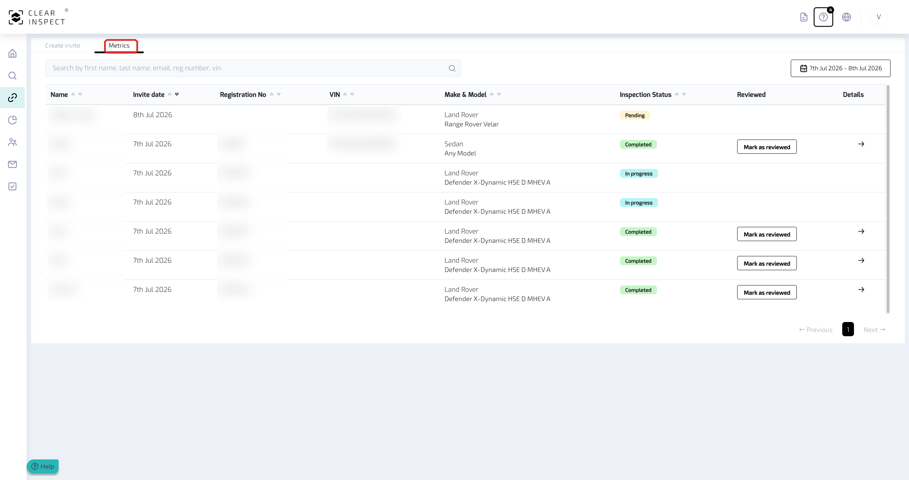

# Tracking invites

After sending an invite, track its progress from the Invite page. The table updates in real time.

## The invite table

Open **Invite** in the sidebar and select the **Metrics** tab. The table lists every invite sent from your retailer (or your own invites, depending on your role). Use the search box and the date-range filter at the top right to narrow the list.

Search by first name, last name, email, registration number or VIN. Each row shows:

* **Name** - the customer's name.
* **Invite date** - when the invite was sent.
* **Registration No** and **VIN** - the vehicle's identifiers.
* **Make & Model**.
* **Inspection Status** - Pending, In progress, or Completed.
* **Reviewed** - once an inspection is Completed, a **Mark as reviewed** button appears.
* **Details** - open the full inspection.

## Opening a completed report

Open the **Details** of any row with an Inspection Status of **Completed** to open the report directly.


Invites expire after 48 hours by default. Once expired, the link no longer works and the customer must be re-invited.

